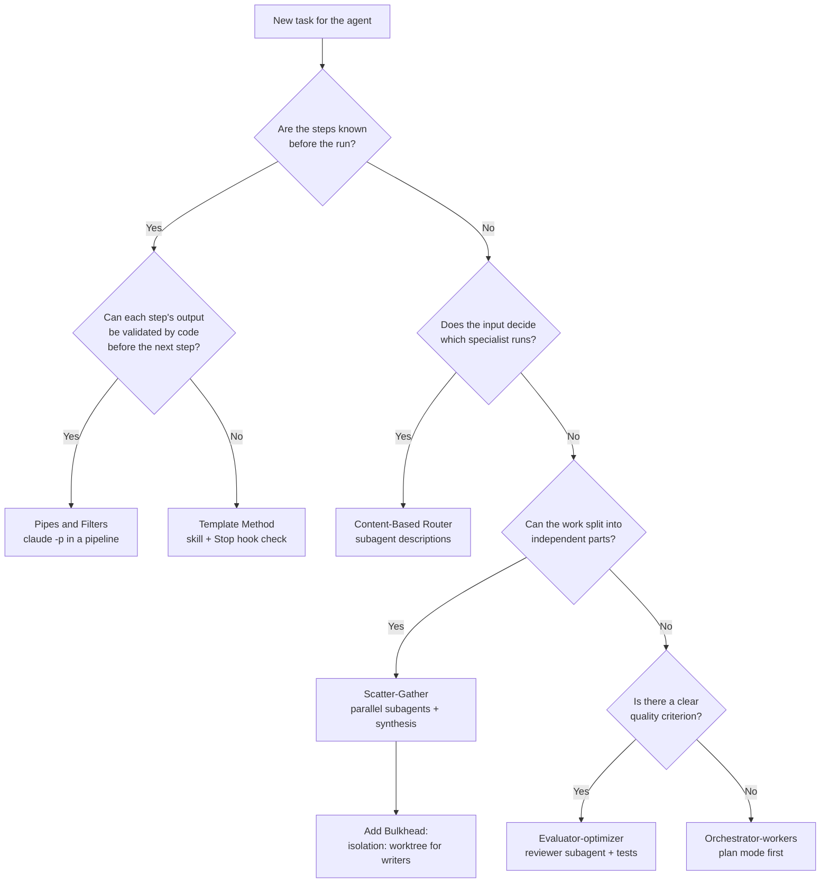

# Паттерны проектирования ИИ для Claude Code: справочник по реализации

Используйте карточки при реализации или проверке паттерна в обвязке агента (agent harness). В каждой карточке указан механизм Claude Code, граница применимости аналогии и проверка, которую можно выполнить. Чтобы сравнить варианты перед выбором, начните с [визуального навигатора по паттернам](https://cc.bruniaux.com/ai-design-patterns/#choose).

> **В работе:** сопоставление двух словарей носит предварительный характер. Эти соответствия предлагаются для обсуждения и уточнения; они будут меняться вместе с Claude Code и источниками. Если какое-либо соответствие в вашем случае не работает, [создайте issue](https://github.com/FlorianBruniaux/claude-code-ultimate-guide/issues) с примером, где оно нарушается. Исследование также опирается на два локальных исследовательских инструмента автора, которые помогают находить и цитировать исходные материалы: [youtube-video-insights](https://github.com/FlorianBruniaux/youtube-video-insights) для поиска по расшифровкам выступлений с временными метками и [paper-insights](https://github.com/FlorianBruniaux/paper-insights) для локального корпуса научных работ с проверенными цитатами.
>
> **Статус:** стандартного взаимного соответствия не существует. Опубликованные сопоставления сходятся по некоторым парам и расходятся по другим, а ни один из изученных для этой страницы источников не сопоставляет классические паттерны с механизмами Claude Code, за исключением хуков и CLAUDE.md. Все остальные элементы столбца Claude Code — это сопоставления данного руководства, помеченные `Our mapping`. Механизмы проверены по [официальной документации](https://code.claude.com/docs/llms-full.txt) (последняя проверка — 2026-10-27). Страница в последний раз обновлена 2026-10-28.
>
> **Используйте эту страницу, чтобы:** объяснять разработчикам устройство агента в знакомых им терминах и проверять проект на режимы отказа, характерные для каждого паттерна. Компоненты обвязки описаны в разделе [Инженерия обвязки агента](./agent-harness.md). Контракты циклов и графов — в разделе [Инженерия циклов и графов](./loop-graph-engineering.md). Паттерны внутри отдельного скилла — в разделе [Паттерны проектирования скиллов](./skill-design-patterns.md).

Таблицы на этой странице генерируются из [`machine-readable/ai-design-patterns.json`](../../machine-readable/ai-design-patterns.json) скриптом `scripts/build-ai-design-patterns.py`. Редактируйте набор данных, а не таблицы.

## Содержание

1. [Коротко](#tldr)
2. [Происхождение](#lineage)
3. [Как читать](#how-to-read)
4. [Таблица соответствий](#crosswalk)
5. [Карточки паттернов](#pattern-cards)
6. [Где аналогия перестаёт работать](#where-the-analogy-breaks)
7. [Нативные агентные паттерны](#native-agent-patterns)
8. [Выбор паттерна](#choose-a-pattern)
9. [Антипаттерны](#anti-patterns)
10. [Классическая сторона](#classic-side)
11. [Дополнительные материалы](#further-reading)
12. [Источники](#sources)

---

## Коротко

- Классические паттерны из этой таблицы по-прежнему описывают агентные системы, но теперь центральным компонентом служит модель, принимающая решения во время выполнения. Паттерн, который полагался на фиксированный порядок или гарантированный вызов, должен сопровождаться детерминированной проверкой.
- В Claude Code наиболее чётко документированы следующие соответствия: Наблюдатель — хукам, Хранитель — контрольным точкам, Посредник — основному диалогу, координирующему субагентов, Изоляция отказов — изоляции контекста субагентов и worktree. Ограничения по числу ходов и бюджету обеспечивают ограниченное выполнение — статическую половину Автоматического выключателя: они останавливают запуск, но не обнаруживают сбои. Только Наблюдатель и Фасад названы источниками; остальные соответствия предложены в этом руководстве.
- Два распространённых предположения неверны в деталях. Хуки одного события выполняются параллельно, поэтому не образуют цепочку. Контрольные точки отслеживают только изменения файлов, внесённые Claude, поэтому откат не отменяет команды оболочки или внешние эффекты.
- Каждая карточка классического паттерна завершается проверкой, которую можно выполнить.

## Происхождение

Три поколения паттернов решают задачи одного рода в разных масштабах:

- **Объектные паттерны** (Gamma, Helm, Johnson, Vlissides, 1994) описывают взаимодействие объектов внутри одной программы. Структуру задаёт разработчик, даже когда поведение меняется во время выполнения, как в паттерне Стратегия.
- **Интеграционные и распределённые паттерны** ([Enterprise Integration Patterns](https://www.enterpriseintegrationpatterns.com/) Hohpe и Woolf, 2003, а также появившиеся позднее паттерны отказоустойчивости) описывают обмен сообщениями между сервисами и их способность переживать частичные отказы.
- **Агентные паттерны** ([Building effective agents](https://www.anthropic.com/engineering/building-effective-agents) от Anthropic, 2024, и последующие каталоги) описывают, как обвязка направляет модель, самостоятельно выбирающую следующее действие.

В работе Jia Huang [Pattern Evolution](https://kage-ai.com/research/pattern-evolution/) третий этап представлен как изменение того, кто выбирает структуру: разработчик, который её программирует, или модель, которая во время выполнения выбирает следующий шаг при неполной информации. Поэтому каждая карточка ниже содержит режим отказа: классическое название описывает структуру, а карточка указывает, какое поведение обвязка больше не гарантирует.

Практики проводят ту же параллель в своих выступлениях. Frank Coyle (UC Berkeley) вспоминает движение 1990-х: «Теперь у нас есть паттерны для агентов, но существуют и антипаттерны» ([выступление, 2:13](https://www.youtube.com/watch?v=Z-c11pV_uvU&t=133s)). Nishant Gupta (Meta Superintelligence Labs) напрямую сопоставляет прежний слой: «Распределённые системы десятилетиями решали нечто похожее» ([выступление, 6:03](https://www.youtube.com/watch?v=APh1Vx0oLmQ&t=363s)). В The Pragmatic Engineer утверждается, что агентам нужны защитные ограничения (guardrails) корпоративных паттернов: «старые паттерны, похоже, возвращаются» ([эпизод, 44:04](https://www.youtube.com/watch?v=5wks1W-auKY&t=2644s)). Выступления по отдельным паттернам приведены в каждой карточке в пункте **Смотреть**.

![Обзор 29 паттернов на этой странице в шести столбцах: порождающие GoF (Фабричный метод, Одиночка), структурные GoF (Адаптер, Компоновщик, Декоратор, Фасад), поведенческие GoF (Цепочка обязанностей, Команда, Посредник, Хранитель, Наблюдатель, Стратегия, Шаблонный метод), интеграционные корпоративные (Каналы и фильтры, Маршрутизатор по содержимому, Рассылка и сбор), распределённые и отказоустойчивые (Изоляция отказов, Автоматический выключатель, Сага, Сайдкар, Журналирование событий) и нативные агентные (Оркестратор и исполнители, Оценщик и оптимизатор, Сначала планирование, затем выполнение, Изоляция контекста, Компакция контекста, Постепенное раскрытие, Детерминированный шлюз, Целевой цикл).](../images/ai-design-patterns/overview-en.webp)

## Как читать

Каждая строка таблицы соответствий содержит две метки.

| Метка | Значение |
|---|---|
| `Consensus` | Два или более независимых источника сопоставляют классический паттерн с одним и тем же основным агентным аналогом. Карточка может добавлять второе толкование, уточняющее первое. |
| `Single source` | Сопоставление предложено одним источником. Рассматривайте его как предложение. |
| `Divergent` | Источники сопоставляют один классический паттерн с разными агентными аналогами. В карточке перечислены все толкования с источниками. |
| `Named by a source` | Сам механизм Claude Code назван источником. |
| `Our mapping` | Источники приводят общий агентный аналог; данное руководство сопоставляет его с Claude Code. |

Строка включается в таблицу только при выполнении трёх условий: существует публичный источник, сопоставляющий классический паттерн с агентным аналогом; существует документированный механизм Claude Code; можно сформулировать режим отказа. Сага — единственное намеренное исключение: в Claude Code нет встроенного механизма компенсации, и строка документирует этот пробел.

## Таблица соответствий

<!-- BEGIN GENERATED: crosswalk-table -->

| Классический паттерн | Семейство | Агентный аналог | В Claude Code | Доказательства | Сопоставление |
|---|---|---|---|---|---|
| [Фабричный метод](#factory-method) | Порождающий GoF | Создание субагента из именованного определения | Определения субагентов и инструмент Agent | Консенсус | Наше сопоставление |
| [Одиночка](#singleton) | Порождающий GoF | Общий реестр инструментов / Многоуровневое управление памятью: определение того, какое состояние будет общим, изолированным, постоянным или временным | Иерархия CLAUDE.md и автоматическая память (общее состояние, но не Одиночка) | Расхождение | Наше сопоставление |
| [Адаптер](#adapter) | Структурный GoF | Адаптер инструмента, предоставляющий модели доступ к внешней системе | MCP-серверы | Консенсус | Наше сопоставление |
| [Компоновщик](#composite) | Структурный GoF | Агент, делегирующий задачи агентам, которые могут делегировать их дальше | Вложенные субагенты (глубина создания) | Консенсус | Наше сопоставление |
| [Декоратор](#decorator) | Структурный GoF | Защитное ограничение вокруг вызова модели / Промежуточный слой внедрения контекста, обогащающий каждый запрос | Хуки UserPromptSubmit и PostToolUse | Расхождение | Наше сопоставление |
| [Фасад](#facade) | Структурный GoF | Файл проектных инструкций как единая точка входа для соглашений | CLAUDE.md | Один источник | Названо источником |
| [Цепочка обязанностей](#chain-of-responsibility) | Поведенческий GoF | Конвейер хуков или прав доступа перед вызовами инструментов / Цепочка агентов, где каждый обрабатывает то, что может, и передаёт остальное дальше | Правила доступа: сначала deny, затем ask, затем allow | Расхождение | Наше сопоставление |
| [Команда](#command) | Поведенческий GoF | Вызов инструмента: именованное действие со структурированными аргументами | Вызовы инструментов и хуки PreToolUse | Консенсус | Наше сопоставление |
| [Посредник](#mediator) | Поведенческий GoF | Оркестратор, координирующий исполнителей, которые не взаимодействуют друг с другом | Основной диалог, координирующий субагентов; команды агентов (Agent Teams) (экспериментальная возможность, по умолчанию отключена; обмен сообщениями между участниками как альтернатива без посредника) | Консенсус | Наше сопоставление |
| [Хранитель](#memento) | Поведенческий GoF | Контрольная точка и откат состояния агента | Контрольные точки и /rewind | Консенсус | Наше сопоставление |
| [Наблюдатель](#observer) | Поведенческий GoF | Хуки жизненного цикла, реагирующие на события агента | Хуки (PreToolUse, PostToolUse, Stop, SubagentStop) | Консенсус | Названо источником |
| [Стратегия](#strategy) | Поведенческий GoF | Модель или подход, выбираемые для каждой задачи / Переключение стратегии во время выполнения с фиксацией в обвязке причин, стоимости и способа отката | Поле model для каждого субагента и /model | Консенсус | Наше сопоставление |
| [Шаблонный метод](#template-method) | Поведенческий GoF | Системный промпт, задающий этапы / Фиксированный каркас агентного цикла с заменяемыми этапами | Скиллы, определяющие процедуру; хук Stop как проверка последнего этапа | Расхождение | Наше сопоставление |
| [Каналы и фильтры](#pipes-and-filters) | Корпоративная интеграция | Конвейер, в котором каждый агент или вызов модели служит фильтром | Режим печати в конвейере оболочки (claude -p) | Консенсус | Наше сопоставление |
| [Маршрутизатор по содержимому](#content-based-router) | Корпоративная интеграция | Классификатор, направляющий запрос специализированному обработчику | Автоматическое делегирование по описанию субагента; выбор скилла по описанию | Консенсус | Наше сопоставление |
| [Рассылка и сбор](#scatter-gather) | Корпоративная интеграция | Параллельные агенты с последующим этапом синтеза | Параллельные субагенты; динамические рабочие процессы | Консенсус | Наше сопоставление |
| [Изоляция отказов](#bulkhead) | Распределённые системы и отказоустойчивость | Изоляция контекста, инструментов и бюджета для каждого агента | Изоляция контекста субагентов; isolation: worktree | Консенсус | Наше сопоставление |
| [Автоматический выключатель](#circuit-breaker) | Распределённые системы и отказоустойчивость | Ограничения числа ходов, оценочной стоимости и глубины цикла / Выключатели для инструментов, моделей и собственного цикла агента | Ограниченное выполнение: --max-turns и --max-budget-usd (режим печати); maxTurns во frontmatter субагента | Консенсус | Наше сопоставление |
| [Сага](#saga) | Распределённые системы и отказоустойчивость | Компенсирующие действия для плана агента | Встроенной саги нет: контрольные точки и компенсация с помощью скриптов | Консенсус | Наше сопоставление |
| [Сайдкар](#sidecar) | Распределённые системы и отказоустойчивость | Обвязка агента вокруг цикла модели | Хуки, права доступа и песочница вокруг цикла | Один источник | Наше сопоставление |
| [Журналирование событий](#event-sourcing) | Распределённые системы и отказоустойчивость | Журнал трассировки как поток событий запуска агента | Расшифровки сессий и возобновление (сохранение диалога) | Один источник | Наше сопоставление |

<!-- END GENERATED: crosswalk-table -->

## Карточки паттернов

<!-- BEGIN GENERATED: pattern-cards -->

### Фабричный метод

`GoF creational` `Consensus` `Our mapping`

- **Классическое назначение:** позволить создателю решать, какой конкретный продукт создавать за общим интерфейсом.
- **Агентная сторона:** создание субагента из именованного определения ([AgentPatterns.ai](https://agentpatterns.ai/patterns/agent-design/classical-se-patterns-agent-analogues/), [Esther Aznar, Ivan Garcia Villar](https://aicodingpatterns.com/patterns/patrones-gof-patrones-agenticos-mapeo-completo/))
- **В Claude Code:** [определения субагентов и инструмент Agent](https://code.claude.com/docs/en/sub-agents)
- **Режим отказа:** фабрика выдаёт каждому продукту полный набор инструментов: определение субагента без поля tools наследует все инструменты, доступные субагентам.
- **Как проверить:** перечислите поле tools каждого определения в .claude/agents/ и отклоняйте проверку, если у агента с правом записи отсутствует явный список разрешённых инструментов.

### Одиночка

`GoF creational` `Divergent` `Our mapping`

- **Классическое назначение:** гарантировать единственный общий экземпляр компонента с глобальной точкой доступа.
- **Агентная сторона, источники расходятся:**
  - Общий реестр инструментов ([Esther Aznar, Ivan Garcia Villar](https://aicodingpatterns.com/patterns/patrones-gof-patrones-agenticos-mapeo-completo/))
  - Многоуровневое управление памятью: определение того, какое состояние будет общим, изолированным, постоянным или временным ([Jia Huang](https://kage-ai.com/research/pattern-evolution/))
- **В Claude Code:** [иерархия CLAUDE.md и автоматическая память (общее состояние, но не Одиночка)](https://code.claude.com/docs/en/memory)
- **Режим отказа:** в этом месте Claude Code не предоставляет Одиночку: загружаются и объединяются несколько файлов CLAUDE.md и памяти, и ничто не гарантирует единственный экземпляр или единую точку доступа. Сохраняется риск неуправляемого общего состояния: параллельные сессии или агенты, одновременно записывающие данные в один файл памяти, могут перезаписать записи друг друга.
- **Как проверить:** запустите две сессии, каждая из которых добавляет запись в один и тот же файл памяти, и проверьте, не потерялась ли одна из записей.
- **Подробнее:** [Системы памяти: встроенный стек памяти Claude Code](memory-systems.md#2-native-claude-code-memory-stack) (руководство); [Постоянная память: шесть сбоев, которые никогда не вызывают ошибку](https://www.florian.bruniaux.com/guides/persistent-memory-silent-failures/) (статья автора)

### Адаптер

`GoF structural` `Consensus` `Our mapping`

- **Классическое назначение:** преобразовать интерфейс существующего компонента в интерфейс, ожидаемый клиентом.
- **Агентная сторона:** адаптер инструмента, предоставляющий модели доступ к внешней системе ([Esther Aznar, Ivan Garcia Villar](https://aicodingpatterns.com/patterns/patrones-gof-patrones-agenticos-mapeo-completo/), [Marco Nissen](https://github.com/agentpatternscatalog/patterns))
- **В Claude Code:** [MCP-серверы](https://code.claude.com/docs/en/mcp)
- **Режим отказа:** адаптер копирует каждую конечную точку вышестоящей системы, поэтому определения инструментов переполняют контекст, а модель выбирает между почти одинаковыми инструментами.
- **Как проверить:** выполните /mcp и /context, а затем удалите или отложите загрузку инструментов, которые не использовались ни в одной задаче последнего спринта.
- **Подробнее:** [Экосистема MCP-серверов](../ecosystem/mcp-servers-ecosystem.md) (руководство); [MCP-серверы: какова их реальная стоимость и когда их использовать](https://www.florian.bruniaux.com/guides/mcp-servers-token-cost/) (статья автора)
- **Смотреть:** Christian Tzolov и Dariusz Jędrzejczyk (Devoxx), [Унификация интеграции ИИ с помощью Model Context Protocol](https://www.youtube.com/watch?v=PJOthBhLbao&t=1262s), 21:02: докладчики объясняют, что каждый поставщик предоставляет собственные API через слой MCP-сервера — унифицированную обёртку, которой может пользоваться LLM.

### Компоновщик

`GoF structural` `Consensus` `Our mapping`

- **Классическое назначение:** работать с отдельным объектом и деревом объектов через один интерфейс.
- **Агентная сторона:** агент, делегирующий задачи агентам, которые могут делегировать их дальше ([AgentPatterns.ai](https://agentpatterns.ai/patterns/agent-design/classical-se-patterns-agent-analogues/), [Esther Aznar, Ivan Garcia Villar](https://aicodingpatterns.com/patterns/patrones-gof-patrones-agenticos-mapeo-completo/))
- **В Claude Code:** [вложенные субагенты (глубина создания)](https://code.claude.com/docs/en/sub-agents)
- **Режим отказа:** рекурсия без бюджета: каждый уровень умножает расход токенов. Claude Code ограничивает вложенность с помощью CLAUDE_CODE_MAX_SUBAGENT_SPAWN_DEPTH; это ограничение можно изменить, но нельзя снять.
- **Как проверить:** явно задайте CLAUDE_CODE_MAX_SUBAGENT_SPAWN_DEPTH для автоматизированных запусков и журналируйте созданных субагентов с помощью хука SubagentStop.
- **Смотреть:** Clément Escoffier и Mario Fusco (Devoxx), [От оркестрации LLM к автономным агентам: паттерны агентного ИИ с LangChain4j](https://www.youtube.com/watch?v=SrFXsjeGc6Q&t=6741s), 112:21: докладчики показывают агента в последовательности, который сам представляет собой цикл из двух агентов, поэтому рабочий процесс используется как единый субагент.

### Декоратор

`GoF structural` `Divergent` `Our mapping`

- **Классическое назначение:** добавлять объекту поведение с помощью обёртки, не изменяя его класс.
- **Агентная сторона, источники расходятся:**
  - Защитное ограничение вокруг вызова модели ([Esther Aznar, Ivan Garcia Villar](https://aicodingpatterns.com/patterns/patrones-gof-patrones-agenticos-mapeo-completo/))
  - Промежуточный слой внедрения контекста, обогащающий каждый запрос ([AgentPatterns.ai](https://agentpatterns.ai/patterns/agent-design/classical-se-patterns-agent-analogues/))
- **В Claude Code:** [хуки UserPromptSubmit и PostToolUse](https://code.claude.com/docs/en/hooks)
- **Режим отказа:** классический стек декораторов выполняется в фиксированном порядке. Подходящие хуки выполняются параллельно, поэтому обёртка, предполагающая, что другая обёртка уже сработала, создаёт состояние гонки.
- **Как проверить:** реализуйте каждый хук так, чтобы он успешно работал отдельно, и протестируйте его при отключённых остальных хуках.
- **Подробнее:** [Справочник по событиям хуков](hooks-events-reference.md) (руководство); [Маршрутизация Smart-Suggest: хук UserPromptSubmit, добавляющий кандидатов-скиллы в промпт](../workflows/smart-suggest-routing.md#claude-code-architecture) (руководство)
- **Смотреть:** Mark Pollack, Christian Tzolov, Josh Long, James Ward (Devoxx), [Bootiful Spring AI](https://www.youtube.com/watch?v=Sw3PlFXfWj4&t=703s), 11:43: докладчик объясняет advisers в Spring AI как фильтр или препроцессор, который оборачивает вызовы к модели и от неё и может изменять или журналировать каждый запрос.
- **Смотреть:** Thariq Shihipar, [Claude Agent SDK [Полный воркшоп]](https://www.youtube.com/watch?v=TqC1qOfiVcQ&t=6430s), 107:10: представитель Anthropic говорит, что хуки срабатывают по событиям в Agent SDK и используются для детерминированной проверки или внедрения контекста.

### Фасад

`GoF structural` `Single source` `Named by a source`

- **Классическое назначение:** предоставить единую простую точку входа перед сложной подсистемой.
- **Агентная сторона:** файл проектных инструкций как единая точка входа для соглашений ([AgentPatterns.ai](https://agentpatterns.ai/patterns/agent-design/classical-se-patterns-agent-analogues/))
- **В Claude Code:** [CLAUDE.md](https://code.claude.com/docs/en/memory)
- **Режим отказа:** фасад воспринимается как контракт. В документации указано, что Claude рассматривает CLAUDE.md как контекст, а не как принудительно применяемую конфигурацию: записанное там правило — это просьба, а не гарантия.
- **Как проверить:** для каждого правила «никогда не делать» в CLAUDE.md добавьте хук PreToolUse или правило deny и тест, который его активирует.
- **Подробнее:** [Ваш CLAUDE.md слишком длинный](https://www.florian.bruniaux.com/blog/articles/your-claudemd-is-too-long/) (статья автора); [ctxharness: проверяет, соответствуют ли проекту утверждения в CLAUDE.md и правилах](https://github.com/FlorianBruniaux/ctxharness) (проект автора); [Инструкции для командного ИИ](../workflows/team-ai-instructions.md) (руководство)

### Цепочка обязанностей

`GoF behavioral` `Divergent` `Our mapping`

- **Классическое назначение:** передавать запрос по цепочке обработчиков, пока один из них его не обработает.
- **Агентная сторона, источники расходятся:**
  - Конвейер хуков или прав доступа перед вызовами инструментов ([AgentPatterns.ai](https://agentpatterns.ai/patterns/agent-design/classical-se-patterns-agent-analogues/), [Ashish Patel](https://github.com/ashishpatel26/agent-harness-engineering-pattern))
  - Цепочка агентов, где каждый обрабатывает то, что может, и передаёт остальное дальше ([Esther Aznar, Ivan Garcia Villar](https://aicodingpatterns.com/patterns/patrones-gof-patrones-agenticos-mapeo-completo/))
- **В Claude Code:** [правила доступа: сначала deny, затем ask, затем allow](https://code.claude.com/docs/en/permissions)
- **Режим отказа:** команды ожидают, что результат определяется порядком объявления или специфичностью правила. В документации указано, что правила проверяются в порядке deny, ask, allow, а специфичность не меняет этот порядок: широкое deny имеет приоритет над узким allow.
- **Как проверить:** в тестовом проекте добавьте deny и более конкретное allow для одной команды и убедитесь, что команда остаётся заблокированной.

### Команда

`GoF behavioral` `Consensus` `Our mapping`

- **Классическое назначение:** превращать запрос в объект, который можно поставить в очередь, записать в журнал, проверить или отменить.
- **Агентная сторона:** вызов инструмента — именованное действие со структурированными аргументами ([Esther Aznar, Ivan Garcia Villar](https://aicodingpatterns.com/patterns/patrones-gof-patrones-agenticos-mapeo-completo/), [Ashish Patel](https://github.com/ashishpatel26/agent-harness-engineering-pattern))
- **В Claude Code:** [вызовы инструментов и хуки PreToolUse](https://code.claude.com/docs/en/tools-reference)
- **Режим отказа:** объект команды создаёт модель. Если аргументы не проверять до отправки, некорректный аргумент или аргумент за пределами области действия выполнится как есть.
- **Как проверить:** передайте хуку PreToolUse записанный ввод инструмента с путём за пределами области действия и убедитесь, что хук его блокирует.
- **Подробнее:** [Справочник по событиям хуков](hooks-events-reference.md) (руководство)

### Посредник

`GoF behavioral` `Consensus` `Our mapping`

- **Классическое назначение:** централизовать взаимодействие набора компонентов, чтобы они не ссылались друг на друга напрямую.
- **Агентная сторона:** оркестратор, координирующий исполнителей, которые не взаимодействуют друг с другом ([Esther Aznar, Ivan Garcia Villar](https://aicodingpatterns.com/patterns/patrones-gof-patrones-agenticos-mapeo-completo/), [Sarkar and Sarkar](https://arxiv.org/abs/2506.05364))
- **В Claude Code:** [основной диалог, координирующий субагентов](https://code.claude.com/docs/en/sub-agents); [команды агентов (Agent Teams) (экспериментальная возможность, по умолчанию отключена; обмен сообщениями между участниками как альтернатива без посредника)](https://code.claude.com/docs/en/agent-teams)
- **Режим отказа:** топология не контролируется принудительно, а посредник может стать узким местом. Субагент, среди инструментов которого есть SendMessage, может напрямую отправлять сообщения другим именованным агентам без использования команд агентов. Если исполнители возвращают расшифровки вместо сводок, координирующий контекст заполняется материалами, которые больше никогда не будут прочитаны.
- **Как проверить:** не включайте SendMessage в инструменты исполнителя, если весь обмен должен проходить через координатора; запрашивайте у каждого субагента итоговый отчёт ограниченного размера и сравнивайте /context до и после делегирования.
- **Подробнее:** [Команды агентов](../workflows/agent-teams.md) (руководство); [Обмен сообщениями между сессиями: сообщения между участниками без посредника](../workflows/cross-session-messaging.md) (руководство)
- **Смотреть:** Sandipan Bhaumik, [От хаоса к хореографии: действительно работающие паттерны многоагентной оркестрации](https://www.youtube.com/watch?v=2czYyrTzILg&t=529s), 8:49: при оркестрации каждый вызов проходит через оркестратор, а агенты никогда не вызывают друг друга.

### Хранитель

`GoF behavioral` `Consensus` `Our mapping`

- **Классическое назначение:** сохранить состояние объекта так, чтобы позднее его можно было восстановить, не раскрывая внутреннего устройства объекта.
- **Агентная сторона:** контрольная точка и откат состояния агента ([AgentPatterns.ai](https://agentpatterns.ai/patterns/agent-design/classical-se-patterns-agent-analogues/), [Ashish Patel](https://github.com/ashishpatel26/agent-harness-engineering-pattern))
- **В Claude Code:** [контрольные точки и /rewind](https://code.claude.com/docs/en/checkpointing)
- **Режим отказа:** снимок неполон. В документации указано, что контрольные точки отслеживают только изменения, внесённые инструментами редактирования файлов Claude; команды Bash и внешние процессы не учитываются, как правило, не учитываются и изменения фонового субагента.
- **Как проверить:** с помощью команды Bash измените файл, который Claude не редактировал в этой сессии, выполните откат и убедитесь, что изменение сохранилось. Перед рискованной работой в оболочке или делегированным редактированием сделайте коммит в git.
- **Смотреть:** Hamza Tahir, [Вашим агентам нужна кнопка сохранения](https://www.youtube.com/watch?v=bZISsg7H7DA&t=14s), 0:14: докладчик утверждает, что агентам нужна кнопка сохранения — контрольные точки во время выполнения, позволяющие повторить выполнение, сравнить изменения и принять решение, а не только просматривать трассировки.

### Наблюдатель

`GoF behavioral` `Consensus` `Named by a source`

- **Классическое назначение:** автоматически уведомлять подписчиков об изменении состояния субъекта.
- **Агентная сторона:** хуки жизненного цикла, реагирующие на события агента ([AgentPatterns.ai](https://agentpatterns.ai/patterns/agent-design/classical-se-patterns-agent-analogues/), [Esther Aznar, Ivan Garcia Villar](https://aicodingpatterns.com/patterns/patrones-gof-patrones-agenticos-mapeo-completo/))
- **В Claude Code:** [хуки (PreToolUse, PostToolUse, Stop, SubagentStop)](https://code.claude.com/docs/en/hooks)
- **Режим отказа:** подписчики предполагают определённый порядок. В документации указано, что подходящие хуки выполняются параллельно, Claude Code объединяет их результаты после завершения всех хуков, а для решений о правах доступа применяется самый строгий результат: deny одного хука не предотвращает побочные эффекты соседнего хука.
- **Как проверить:** отдельно запустите каждый хук на записанных данных события; хук, который успешно работает только после другого хука, не является наблюдателем.
- **Подробнее:** [Справочник по событиям хуков](hooks-events-reference.md) (руководство); [Внутреннее устройство Claude Code](https://www.florian.bruniaux.com/blog/articles/claude-code-under-the-hood/) (статья автора)
- **Смотреть:** Cole Medin, [Посмотрите это, если ваш агент для программирования игнорирует правила (вам нужны хуки)](https://www.youtube.com/watch?v=msfMqW92Y8Q&t=44s), 0:44: докладчик определяет хуки как действия, которые гарантированно выполняются при событиях агента, например непосредственно перед чтением файла или при остановке диалога.

### Стратегия

`GoF behavioral` `Consensus` `Our mapping`

- **Классическое назначение:** во время выполнения заменять один алгоритм другим за тем же интерфейсом.
- **Агентная сторона, сначала основное толкование:**
  - Модель или подход, выбираемые для конкретной задачи ([AgentPatterns.ai](https://agentpatterns.ai/patterns/agent-design/classical-se-patterns-agent-analogues/), [Esther Aznar, Ivan Garcia Villar](https://aicodingpatterns.com/patterns/patrones-gof-patrones-agenticos-mapeo-completo/))
  - Переключение стратегии во время выполнения с фиксацией в обвязке причин, стоимости и способа отката ([Jia Huang](https://kage-ai.com/research/pattern-evolution/))
- **В Claude Code:** [поле model для каждого субагента и /model](https://code.claude.com/docs/en/model-config)
- **Режим отказа:** стратегия меняется незаметно. После выполнения невозможно определить, какая модель создала конкретный результат и сколько стоило переключение.
- **Как проверить:** закрепите model в определении каждого субагента и после запуска проверьте /usage или расшифровку сессии.
- **Подробнее:** [agent-router-core: экспериментальный CLI для детерминированной маршрутизации агентных рабочих процессов](https://github.com/FlorianBruniaux/agent-router-core) (проект автора); [cc-copilot-bridge: маршрутизация между несколькими поставщиками для Claude Code](https://ccbridge.bruniaux.com/) (проект автора); [Измерение собственного использования ИИ: три счётчика, три разных ответа](https://www.florian.bruniaux.com/blog/articles/real-cost-of-ai-measuring-your-own-usage/) (статья автора)
- **Смотреть:** Archana Kamath и Tyler Gillam, [Предпочтения вместо бенчмарков: маршрутизация моделей](https://www.youtube.com/watch?v=FvxY8oPoI8o&t=106s), 1:46: докладчик утверждает, что использовать одну модель для каждой задачи избыточно, а маршрутизация каждой задачи к подходящей модели снижает стоимость и риск.

### Шаблонный метод

`GoF behavioral` `Divergent` `Our mapping`

- **Классическое назначение:** зафиксировать каркас алгоритма, позволив подклассам реализовать отдельные этапы.
- **Агентная сторона, источники расходятся:**
  - Системный промпт, задающий этапы ([Esther Aznar, Ivan Garcia Villar](https://aicodingpatterns.com/patterns/patrones-gof-patrones-agenticos-mapeo-completo/))
  - Фиксированный каркас агентного цикла с заменяемыми этапами ([Ashish Patel](https://github.com/ashishpatel26/agent-harness-engineering-pattern))
- **В Claude Code:** [скиллы, определяющие процедуру](https://code.claude.com/docs/en/skills); [хук Stop как проверка последнего этапа](https://code.claude.com/docs/en/hooks)
- **Режим отказа:** текстовый каркас не контролируется принудительно: модель может пропустить или переставить этапы, в отличие от базового класса, который сам вызывает их.
- **Как проверить:** предусмотрите для последнего этапа артефакт — файл или запуск тестов — и блокируйте завершение хуком Stop, если артефакт отсутствует.
- **Подробнее:** [Паттерны проектирования скиллов](skill-design-patterns.md) (руководство); [TDD с Claude](../workflows/tdd-with-claude.md) (руководство); [TDD с Claude Code](https://www.florian.bruniaux.com/guides/tdd-with-claude-code/) (статья автора)
- **Смотреть:** Cole Medin, [Агенты для программирования в Stripe создают 1 300 PR КАЖДУЮ неделю — вот как они это делают](https://www.youtube.com/watch?v=NMWgXvm--to&t=421s), 7:01: докладчик описывает чертежи Stripe — скиллы агентов, объединённые с детерминированным кодом в фиксированном рабочем процессе.

### Каналы и фильтры

`Enterprise integration` `Consensus` `Our mapping`

- **Классическое назначение:** обрабатывать сообщение последовательностью независимых этапов, соединённых каналами.
- **Агентная сторона:** конвейер, в котором каждый агент или вызов модели служит фильтром ([Roan Brasil](https://github.com/roanbrasil/agents-integration-patterns), [Marco Nissen](https://github.com/agentpatternscatalog/patterns))
- **В Claude Code:** [режим печати в конвейере оболочки (claude -p)](https://code.claude.com/docs/en/headless)
- **Режим отказа:** фильтр выдаёт свободный текст, который следующий фильтр интерпретирует неверно, после чего ошибка распространяется дальше по конвейеру.
- **Как проверить:** используйте --output-format json между этапами и проверяйте структуру данных до запуска следующего фильтра.
- **Подробнее:** [Рабочие процессы GitHub Actions](../workflows/github-actions.md) (руководство)
- **Смотреть:** Mark Pollack, Christian Tzolov, Josh Long, James Ward (Devoxx), [Bootiful Spring AI](https://www.youtube.com/watch?v=Sw3PlFXfWj4&t=2291s), 38:11: докладчик передаёт git log в claude -p для создания примечаний к выпуску и называет это очередным возвращением каналов и фильтров.
- **Смотреть:** Kevin Dubois и Mario Fusco (Devoxx), [Паттерны агентного ИИ](https://www.youtube.com/watch?v=X9baI7RBhqk&t=491s), 8:11: докладчики представляют паттерн последовательности — вызов одного агента за другим, также известный как цепочка промптов.

### Маршрутизатор по содержимому

`Enterprise integration` `Consensus` `Our mapping`

- **Классическое назначение:** направлять каждое сообщение адресату на основании его содержимого.
- **Агентная сторона:** классификатор, направляющий запрос специализированному обработчику ([Roan Brasil](https://github.com/roanbrasil/agents-integration-patterns), [Anthropic](https://www.anthropic.com/engineering/building-effective-agents))
- **В Claude Code:** [автоматическое делегирование по описанию субагента](https://code.claude.com/docs/en/sub-agents); [выбор скилла по описанию](https://code.claude.com/docs/en/skills)
- **Режим отказа:** из-за пересекающихся описаний один и тот же запрос в разных запусках направляется разным обработчикам.
- **Как проверить:** поддерживайте набор маршрутизационных промптов с ожидаемым субагентом или скиллом и повторно запускайте его после каждого изменения описаний.
- **Подробнее:** [Маршрутизатор BM25, шаг за шагом](../workflows/smart-suggest-routing.md#bm25-router-step-by-step) (руководство); [Готовый к запуску хук маршрутизации BM25](../../examples/hooks/bm25-routing/README.md) (шаблон); [cc-skill-usage: подсчитывает реальные вызовы Skill в расшифровках](https://github.com/FlorianBruniaux/cc-skill-usage) (проект автора)
- **Смотреть:** Goulven Le Dû (Doctolib), [Alfred — система агентного ИИ Doctolib на службе медицинских специалистов](https://www.youtube.com/watch?v=uTM3fRgbUN0&t=252s), 4:12: в Alfred от Doctolib есть агент-маршрутизатор, использующий модель классификации намерений для направления каждого запроса специализированному агенту.
- **Смотреть:** Renato Guerra Cavalcanti (Devoxx), [Akka: корпоративная среда выполнения для отказоустойчивого агентного ИИ](https://www.youtube.com/watch?v=PrIh_9HomfI&t=821s), 13:41: докладчик описывает маршрутизатор, который получает сообщение и с помощью LLM или обычных if и else решает, какому агенту его передать.

### Рассылка и сбор

`Enterprise integration` `Consensus` `Our mapping`

- **Классическое назначение:** отправить запрос нескольким получателям и агрегировать их ответы.
- **Агентная сторона:** параллельные агенты с последующим этапом синтеза ([Esther Aznar, Ivan Garcia Villar](https://aicodingpatterns.com/patterns/patrones-gof-patrones-agenticos-mapeo-completo/), [Roan Brasil](https://github.com/roanbrasil/agents-integration-patterns))
- **В Claude Code:** [параллельные субагенты](https://code.claude.com/docs/en/sub-agents); [динамические рабочие процессы](https://code.claude.com/docs/en/workflows)
- **Режим отказа:** этап сбора усредняет противоречащие друг другу ответы вместо их согласования, а расход токенов растёт с каждой ветвью.
- **Как проверить:** потребуйте от этапа синтеза явно перечислять разногласия и сравните стоимость запуска с базовым вариантом, использующим одного агента.
- **Подробнее:** [Динамические рабочие процессы](../workflows/dynamic-workflows.md) (руководство); [Best-of-N](../workflows/best-of-n.md) (руководство); [Проверка кода несколькими поставщиками](../workflows/multi-provider-code-review.md) (руководство)
- **Смотреть:** Renato Guerra Cavalcanti (Devoxx), [Akka: корпоративная среда выполнения для отказоустойчивого агентного ИИ](https://www.youtube.com/watch?v=PrIh_9HomfI&t=786s), 13:06: докладчик описывает параллельный вызов нескольких агентов, ожидание всех результатов и передачу их агенту, создающему сводку.
- **Смотреть:** Colin (LangChain), [Динамические субагенты: как надёжно запускать параллельных агентов в Deep Agents](https://www.youtube.com/watch?v=5AkdMangfNk&t=46s), 0:46: в демонстрации агент параллельно запускает 15 субагентов, а затем выбирает лучший результат.

### Изоляция отказов

`Distributed and resilience` `Consensus` `Our mapping`

- **Классическое назначение:** изолировать ресурсы для каждого потребителя, чтобы один отказ не вывел из строя всю систему.
- **Агентная сторона:** изоляция контекста, инструментов и бюджета для каждого агента ([Esther Aznar, Ivan Garcia Villar](https://aicodingpatterns.com/patterns/patrones-gof-patrones-agenticos-mapeo-completo/), [Jia Huang](https://kage-ai.com/research/pattern-evolution/))
- **В Claude Code:** [изоляция контекста субагентов](https://code.claude.com/docs/en/sub-agents); [isolation: worktree](https://code.claude.com/docs/en/worktrees)
- **Режим отказа:** изолирован только контекст. Параллельные агенты по-прежнему используют одну рабочую копию и перезаписывают файлы друг друга.
- **Как проверить:** задайте для параллельных субагентов с правом записи isolation: worktree и убедитесь, что во время запуска git status в основной рабочей копии остаётся чистым.
- **Подробнее:** [Изоляция песочницы](../security/sandbox-isolation.md) (руководство); [Планирование и выполнение: запуск более 20 агентов для миграции (изоляция worktree)](https://www.florian.bruniaux.com/guides/plan-execute-migrations/) (статья автора); [wt-sweep: обнаруживает Git worktree и проверяет доказательства интеграции](https://wt-sweep.bruniaux.com/) (проект автора)

### Автоматический выключатель

`Distributed and resilience` `Consensus` `Our mapping`

- **Классическое назначение:** после повторяющихся сбоев прекратить вызовы сбойной зависимости и быстро завершаться с ошибкой.
- **Агентная сторона, сначала основное толкование:**
  - Ограничения числа ходов, оценочной стоимости и глубины цикла ([AgentPatterns.ai](https://agentpatterns.ai/patterns/agent-design/classical-se-patterns-agent-analogues/), [Esther Aznar, Ivan Garcia Villar](https://aicodingpatterns.com/patterns/patrones-gof-patrones-agenticos-mapeo-completo/), [James Davies](https://github.com/jlldavies/go4-llm-design-patterns))
  - Выключатели для инструментов, моделей и собственного цикла агента ([Jia Huang](https://kage-ai.com/research/pattern-evolution/))
- **В Claude Code:** [ограниченное выполнение: --max-turns и --max-budget-usd (режим печати)](https://code.claude.com/docs/en/cli-reference); [maxTurns во frontmatter субагента](https://code.claude.com/docs/en/sub-agents)
- **Режим отказа:** эти ограничения обеспечивают ограниченное выполнение, но не являются выключателем. Автоматический выключатель отслеживает сбои и размыкает цепь; данные ограничения фиксируются до запуска и не отслеживают сбои. По умолчанию --max-turns не ограничен и подсчитывает ходы, а не стоимость. --max-budget-usd останавливает выполнение на основании клиентской оценки стоимости, и документация предупреждает, что расходы могут превысить ограничение, поэтому оставляйте запас.
- **Как проверить:** запустите автоматизированную задачу, намеренно склонную к зацикливанию, с заданными --max-turns и --max-budget-usd и проверьте, что она завершается с ошибкой, а также насколько указанные расходы превысили ограничение.
- **Подробнее:** [Инженерия циклов и графов: составление контракта цикла](loop-graph-engineering.md#2-write-a-loop-contract) (руководство); [Проектирование ограниченного цикла проверки](https://www.florian.bruniaux.com/guides/bounded-code-review-loop/) (статья автора)
- **Смотреть:** Sandipan Bhaumik, [От хаоса к хореографии: действительно работающие паттерны многоагентной оркестрации](https://www.youtube.com/watch?v=2czYyrTzILg&t=1011s), 16:51: докладчик применяет Автоматический выключатель к вызовам между агентами: после повторяющихся сбоев цепь размыкается и быстро завершается с ошибкой, а затем переходит в полуразомкнутое состояние для проверки восстановления.
- **Смотреть:** Tisha Chawla и Susheem Koul, [FinOps для ИИ-агентов: кто потратил все токены?](https://www.youtube.com/watch?v=GJX19pNhmSw&t=1056s), 17:36: в демонстрации агент, превысивший бюджет запуска, немедленно завершается, что докладчик называет простым автоматическим выключателем.

### Сага

`Distributed and resilience` `Consensus` `Our mapping`

- **Классическое назначение:** выполнять длительную транзакцию как последовательность локальных этапов, у каждого из которых есть компенсирующее действие на случай сбоя последующего этапа.
- **Агентная сторона:** компенсирующие действия для плана агента ([AgentPatterns.ai](https://agentpatterns.ai/patterns/agent-design/classical-se-patterns-agent-analogues/), [Esther Aznar, Ivan Garcia Villar](https://aicodingpatterns.com/patterns/patrones-gof-patrones-agenticos-mapeo-completo/), [Jia Huang](https://kage-ai.com/research/pattern-evolution/), [Vasundra Srinivasan](https://arxiv.org/abs/2605.20173))
- **В Claude Code:** [встроенной саги нет: контрольные точки и компенсация с помощью скриптов](https://code.claude.com/docs/en/checkpointing)
- **Режим отказа:** откат ошибочно принимают за компенсацию. Он восстанавливает только локальные изменения файлов; push, вызов API или запись в базу данных остаются выполненными.
- **Как проверить:** перед запуском запишите компенсирующее действие для каждого этапа плана агента с побочными эффектами и один раз протестируйте это действие.
- **Подробнее:** [Инженерия циклов и графов: согласование прерванных эффектов перед повторной попыткой](loop-graph-engineering.md#reconcile-interrupted-effects-before-retrying) (руководство); [Безопасность в продакшене](../security/production-safety.md) (руководство)
- **Смотреть:** Sandipan Bhaumik, [От хаоса к хореографии: действительно работающие паттерны многоагентной оркестрации](https://www.youtube.com/watch?v=2czYyrTzILg&t=1142s), 19:02: докладчик представляет паттерн компенсации, или Сагу: у каждого агента есть execute и compensate, а при сбое оркестратор движется назад, вызывая compensate.
- **Смотреть:** Salman Munaf, [Теперь ИИ-агенты — это просто распределённые системы](https://www.youtube.com/watch?v=hD9-V56FNRI&t=730s), 12:10: докладчик говорит, что многоэтапный агент, давший сбой на середине выполнения, должен отменить всю транзакцию в нескольких системах, для чего требуется определённая операция компенсации.

### Сайдкар

`Distributed and resilience` `Single source` `Our mapping`

- **Классическое назначение:** подключать сквозные возможности — журналирование, политики, сетевое взаимодействие — рядом с сервисом, а не внутри него.
- **Агентная сторона:** обвязка агента вокруг цикла модели ([Jia Huang](https://kage-ai.com/research/pattern-evolution/))
- **В Claude Code:** [хуки, права доступа и песочница вокруг цикла](https://code.claude.com/docs/en/sandboxing)
- **Режим отказа:** политика находится в промпте, а не в сайдкаре, поэтому модель может убедить себя её не соблюдать. Хук политики также может пропускать действия при сбое: для большинства событий хук, который аварийно завершается или превышает время ожидания, пропускает действие, если для него не задано onFailure: "block".
- **Как проверить:** перечислите все правила безопасности и укажите слой, который обеспечивает их выполнение: хук, правило доступа, песочница или только промпт. Для каждого хука политики укажите путь к отсутствующему скрипту и убедитесь, что действие блокируется.
- **Подробнее:** [Встроенная песочница](../security/sandbox-native.md) (руководство); [Безопасность Claude Code: поверхность атаки, которую проверяют лишь немногие команды](https://www.florian.bruniaux.com/guides/claude-code-attack-surface/) (статья автора)

### Журналирование событий

`Distributed and resilience` `Single source` `Our mapping`

- **Классическое назначение:** сохранять каждое изменение состояния как событие и восстанавливать состояние повторным воспроизведением журнала.
- **Агентная сторона:** журнал трассировки как поток событий запуска агента ([Jia Huang](https://kage-ai.com/research/pattern-evolution/))
- **В Claude Code:** [расшифровки сессий и возобновление (сохранение диалога)](https://code.claude.com/docs/en/sessions)
- **Режим отказа:** расшифровку принимают за полный журнал событий. Она записывает диалог, включая ответы модели и результаты инструментов, поэтому --resume восстанавливает диалог без повторного вызова модели. Она не записывает состояние файлов, веток или сервисов, изменённых сессией, поэтому не может восстановить это состояние, а ходы после возобновления представляют собой новые вызовы модели.
- **Как проверить:** прежде чем полагаться на возобновлённую сессию, убедитесь, что файлы, ветка и сервисы всё ещё соответствуют её предположениям, а состояние, которое потребуется восстановить, храните в git или явном журнале.
- **Подробнее:** [Наблюдаемость: поиск и возобновление сессий](../ops/observability.md) (руководство); [Прослеживаемость ИИ](../ops/ai-traceability.md) (руководство); [cc-sessions: поиск и анализ истории сессий Claude Code](https://github.com/FlorianBruniaux/cc-sessions) (проект автора)
- **Смотреть:** Jonas Templestein, [Создание собственной обвязки агента с журналированием событий с помощью потоковых процессоров](https://www.youtube.com/watch?v=vi-2nasppAg&t=105s), 1:45: докладчик хочет создать обвязку агента для программирования, полностью основанную на журналировании событий, поскольку агент уже ведёт журнал событий.
- **Смотреть:** Ishaan Sehgal, [Журнал — это и есть агент](https://www.youtube.com/watch?v=UPwGaM2MKHY&t=259s), 4:19: докладчик утверждает, что журнал представляет собой долговечную историю, из которой проецируется каждое представление агента — для отладки, аудита или компакции.

<!-- END GENERATED: pattern-cards -->

## Где аналогия перестаёт работать

![Четыре классические гарантии и то, чем они заменяются в обвязке агента: стек декораторов с фиксированным порядком превращается в хуки, выполняющиеся параллельно; хранитель, восстанавливающий полное состояние, превращается в контрольные точки, отслеживающие только изменения файлов, внесённые Claude; журнал событий, восстанавливающий всё состояние, превращается в расшифровку, сохраняющую диалог, но не состояние; фасад, обеспечивающий соблюдение контракта, превращается в файл CLAUDE.md, читаемый как контекст.](../images/ai-design-patterns/analogy-breaks-en.webp)

У всех описанных ниже нарушений одна причина: классический паттерн предполагает, что центральный компонент выполняет то, что ему передано, а модель этого не гарантирует.

**Порядок не гарантируется.** Стек декораторов и цепочка обработчиков выполняются в известном порядке. Claude Code запускает подходящие хуки одного события параллельно, а при принятии решений о правах доступа применяется самый строгий результат ([справочник по хукам](https://code.claude.com/docs/en/hooks)). Claude Code объединяет результаты после завершения всех подходящих хуков, поэтому deny одного хука не останавливает побочные эффекты другого; отменяется только хук, достигший лимита времени ([руководство по хукам](https://code.claude.com/docs/en/hooks-guide)). Реализуйте каждый хук так, чтобы он был корректен сам по себе. В отличие от хуков, правила доступа проверяются в документированном порядке: deny, затем ask, затем allow, причём специфичность не меняет этот порядок ([права доступа](https://code.claude.com/docs/en/permissions)).

**Восстановление неполно.** Хранитель сохраняет всё необходимое состояние. Контрольные точки отслеживают только изменения, внесённые инструментами редактирования файлов Claude; изменения от команд Bash или внешних процессов не учитываются ([контрольные точки](https://code.claude.com/docs/en/checkpointing)). Изменения фонового субагента обычно также находятся за пределами контрольных точек: откат восстанавливает только файлы, которые Claude уже редактировал в диалоге. Для всего остального применяется вопрос Саги: какое предусмотрено компенсирующее действие и кто его выполняет?

**Журнал не содержит всё состояние.** Система с журналированием событий восстанавливает состояние из журнала, поскольку каждое изменение состояния представлено в нём событием. Расшифровка Claude Code записывает диалог, включая результаты инструментов, поэтому возобновлённая сессия получает диалог без новых вызовов модели. Она не записывает файлы, ветки или сервисы, изменённые сессией, поэтому не может их восстановить, а действия модели после возобновления относятся уже к новому запуску. Используйте расшифровку как аудиторский след, а состояние, которое потребуется восстановить, храните в git или явном журнале.

**Текст не обеспечивает принудительное соблюдение.** Шаблонный метод вызывает свои этапы; фасад является кодом, поэтому каждый вызов проходит через него. Скилл, перечисляющий этапы, или файл CLAUDE.md, задающий правила, — это контекст, который читает модель. Документация говорит об этом прямо: Claude рассматривает CLAUDE.md как контекст, а не как принудительно применяемую конфигурацию, и рекомендует хук PreToolUse, чтобы блокировать действие независимо от решения Claude ([память](https://code.claude.com/docs/en/memory)).

**Наблюдатели могут наложить вето.** Классический наблюдатель получает уведомление и не может изменить действия субъекта. Хук PreToolUse может заблокировать наблюдаемый вызов инструмента, поэтому хук ближе к защитному механизму, чем к слушателю. Вето действует только в одну сторону: результат allow от хука не обходит правила доступа — подходящее правило deny или ask всё равно применяется ([права доступа](https://code.claude.com/docs/en/permissions)).

**Защитные механизмы пропускают действия при сбое.** Классический защитный механизм при исключении останавливает запрос. Для большинства событий хук Claude Code, который аварийно завершается, не может запуститься или превышает время ожидания, пропускает действие, поэтому хук политики с неверным путём ничего не обеспечивает. Чтобы изменить это поведение, задайте `"onFailure": "block"` для командного или HTTP-хука; возможность доступна начиная с Claude Code v2.1.295 ([справочник по хукам](https://code.claude.com/docs/en/hooks)).

**Ограничения статичны.** Классический Автоматический выключатель размыкается после повторяющихся сбоев и снова замыкается после периода ожидания. `--max-turns`, `--max-budget-usd` и `maxTurns` — фиксированные ограничения, задаваемые до запуска ([справочник CLI](https://code.claude.com/docs/en/cli-reference)): они ограничивают цикл, но не обнаруживают сбойную зависимость. Ограничение бюджета проверяется относительно клиентской оценки стоимости, и документация предупреждает, что расходы могут его превысить.

**Обёртка тоже вероятностна.** Несколько источников сопоставляют Декоратор с защитными ограничениями или внедрением контекста. Защитное ограничение, которое само реализовано как вызов модели, наследует неопределённость, которую должно сдерживать. На любом пути, который не должен завершиться сбоем, сохраняйте хотя бы одну детерминированную проверку.

## Нативные агентные паттерны

Эти паттерны близки к классическим, но зависят от двух вещей, которыми классическим паттернам никогда не приходилось управлять: контекстного окна как дефицитного ресурса и модели как компонента, принимающего решения. Если похожий механизм присутствует в таблице соответствий, карточка указывает ближайший классический паттерн и объясняет различия.

<!-- BEGIN GENERATED: native-cards -->

### Оркестратор и исполнители

Центральная модель во время выполнения разбивает задачу на части, делегирует их и синтезирует результаты.

- **Что нового:** ближайший классический паттерн — Посредник. Отличие состоит в том, что декомпозицию во время запуска определяет модель, а не проектировщик. Делегирование окупается при параллельной работе: в контролируемом исследовании Google Research все многоагентные варианты ухудшили результаты последовательной задачи планирования на 39–70%.
- **В Claude Code:** [субагенты](https://code.claude.com/docs/en/sub-agents); [динамические рабочие процессы](https://code.claude.com/docs/en/workflows)
- **Источники:** [Anthropic](https://www.anthropic.com/engineering/building-effective-agents), [документация Claude Code: субагенты](https://code.claude.com/docs/en/sub-agents), [документация Claude Code: динамические рабочие процессы](https://code.claude.com/docs/en/workflows), [Yubin Kim, Xin Liu (Google Research)](https://research.google/blog/towards-a-science-of-scaling-agent-systems-when-and-why-agent-systems-work/)
- **Подробнее:** [Динамические рабочие процессы](../workflows/dynamic-workflows.md) (руководство); [Команды агентов](../workflows/agent-teams.md) (руководство); [Планирование и выполнение: запуск более 20 агентов для миграции](https://www.florian.bruniaux.com/guides/plan-execute-migrations/) (статья автора)
- **Смотреть:** Luke Alvoeiro, [Многоагентная архитектура, которая действительно доходит до продакшена](https://www.youtube.com/watch?v=ow1we5PzK-o&t=276s), 4:36: докладчик описывает систему Missions от Factory как оркестратор, который планирует, исполнителей, которые выполняют, и валидаторов, которые проверяют.

### Оценщик и оптимизатор

Один вызов создаёт ответ, другой оценивает его и передаёт обратную связь — в цикле.

- **Что нового:** тестовым оракулом служит сама модель, поэтому цикл может сойтись на неверном ответе, который принимают обе стороны.
- **В Claude Code:** [субагент-рецензент с собственным контекстом](https://code.claude.com/docs/en/sub-agents); [хук Stop, запускающий настоящие тесты](https://code.claude.com/docs/en/hooks)
- **Источники:** [Anthropic](https://www.anthropic.com/engineering/building-effective-agents), [документация Claude Code: субагенты](https://code.claude.com/docs/en/sub-agents), [документация Claude Code: справочник по хукам](https://code.claude.com/docs/en/hooks)
- **Подробнее:** [Best-of-N](../workflows/best-of-n.md) (руководство); [Когда независимый рецензент оправдывает своё участие](https://www.florian.bruniaux.com/blog/articles/reviewer-you-ignore/) (статья автора); [Проектирование ограниченного цикла проверки](https://www.florian.bruniaux.com/guides/bounded-code-review-loop/) (статья автора)
- **Смотреть:** Ash Prabaker и Andrew Wilson, [Воркшоп Anthropic: создаём агентов, способных работать часами](https://www.youtube.com/watch?v=mR-WAvEPRwE&t=1141s), 19:01: докладчики описывают генератор и оценщик в отдельных контекстах, где оценщик проверяет результат с помощью Playwright и возвращает критические замечания.
- **Смотреть:** Luke Alvoeiro, [Многоагентная архитектура, которая действительно доходит до продакшена](https://www.youtube.com/watch?v=ow1we5PzK-o&t=334s), 5:34: отдельная роль валидатора проверяет работу, включая сквозное поведение, а не только читает код.

### Сначала планирование, затем выполнение

Отделите фазу планирования только для чтения от фазы, изменяющей файлы.

- **Что нового:** план представляет собой проверяемый артефакт, созданный до изменения файлов, поэтому неверный подход можно обнаружить до того, как он приведёт к затратам на редактирование. Проверка плана добавляет контрольную точку, но не заменяет проверку последующего кода; кроме того, модель, выполняющая план, может отличаться от модели, которая его составила (opusplan планирует с Opus и выполняет с Sonnet).
- **В Claude Code:** [режим планирования](https://code.claude.com/docs/en/permission-modes)
- **Источники:** [Nikola Balic и участники проекта](https://github.com/nibzard/awesome-agentic-patterns), [документация Claude Code: режимы прав доступа](https://code.claude.com/docs/en/permission-modes), [документация Claude Code: конфигурация модели](https://code.claude.com/docs/en/model-config)
- **Подробнее:** [Рабочий процесс на основе плана](../workflows/plan-driven.md) (руководство); [Планирование с двумя экземплярами](../workflows/dual-instance-planning.md) (руководство); [Планирование и выполнение: запуск более 20 агентов для миграции](https://www.florian.bruniaux.com/guides/plan-execute-migrations/) (статья автора)
- **Смотреть:** Matt Pocock, [Я скептически относился к ИИ. Затем попробовал режим планирования](https://www.youtube.com/watch?v=WNx-s-RxVxk&t=22s), 0:22: докладчик планирует каждое изменение в режиме планирования, поручает ИИ выполнить план, а затем тестирует и делает коммит.

### Изоляция контекста

Выполните шумную побочную задачу в отдельном контексте и верните сводку результата.

- **Что нового:** ближайший классический паттерн — Изоляция отказов. Здесь защищаемым ресурсом служит контекстное окно, а не потоки или соединения.
- **В Claude Code:** [субагенты работают в собственном контексте и возвращают сводку](https://code.claude.com/docs/en/sub-agents)
- **Источники:** [Lance Martin](https://rlancemartin.github.io/2026/01/09/agent_design/), [документация Claude Code: субагенты](https://code.claude.com/docs/en/sub-agents)
- **Подробнее:** [Инженерия обвязки агента: управление субагентами](agent-harness.md#24-sub-agent-management) (руководство)
- **Смотреть:** Colin (LangChain), [Динамические субагенты: как надёжно запускать параллельных агентов в Deep Agents](https://www.youtube.com/watch?v=5AkdMangfNk&t=110s), 1:50: субагенты обеспечивают изоляцию контекста — каждый работает в собственном контекстном окне и возвращает только результаты, поэтому контекст основного агента остаётся чистым.
- **Смотреть:** Frank Coyle, [Экзамен CCA от Anthropic как практическое руководство по агентной инженерии](https://www.youtube.com/watch?v=Z-c11pV_uvU&t=917s), 15:17: докладчик называет антипаттерном ситуацию, когда каждая подзадача выгружает полный результат в основной поток, и рекомендует вместо этого изолировать результаты подзадач.

### Компакция контекста

Резюмируйте разговор, когда он приближается к пределу контекстного окна, и продолжайте работу на основе резюме.

- **Что нового:** Состояние намеренно сохраняется с потерями: всё, что было отброшено из резюме, исчезает из активного контекста, пока какой-либо механизм не загрузит это снова. Claude Code повторно внедряет проектный CLAUDE.md, автоматическую память, план и вызванные скиллы (в ограниченном объёме), а также заново читает до пяти недавно использованных файлов; остальная часть разговора сохраняется только в виде резюме.
- **В Claude Code:** [Автоматическая компакция и /compact](https://code.claude.com/docs/en/context-window)
- **Источники:** [Lance Martin](https://rlancemartin.github.io/2026/01/09/agent_design/), [Nikola Balic и соавторы](https://github.com/nibzard/awesome-agentic-patterns), [Документация Claude Code: контекстное окно](https://code.claude.com/docs/en/context-window)
- **Подробнее:** [Архитектура: автоматическая компакция](architecture.md#auto-compaction) (руководство); [Системы памяти: не смешивайте историю с компакцией](memory-systems.md#keep-history-distinct-from-compaction) (руководство)
- **Видео:** Louis-François Bouchard, Omar Solano и Samridhi Vaid (Towards AI), [Инженерия контекста в 2026 году](https://www.youtube.com/watch?v=WP3hjUXd918&t=535s), с 8:55: выступающие определяют компакцию как сохранение минимального контекста, которого всё ещё достаточно для ответа на вопрос, с отбрасыванием или сохранением в другом месте всего остального.
- **Видео:** Ishaan Sehgal, [Лог — это агент](https://www.youtube.com/watch?v=UPwGaM2MKHY&t=272s), с 4:32: докладчик объясняет, что лог может расти бесконечно, а представление модели — нет, поэтому лог необходимо сжимать в меньшее представление с потерями.

### Прогрессивное раскрытие

Сначала загружайте краткие описания, а полные инструкции — только тогда, когда они понадобятся.

- **Что нового:** Выбор происходит на основе описаний, которые читает модель, поэтому расплывчатое описание скрывает возможность. Исключение — скиллы, предварительно загруженные через поле skills субагента: их полное содержимое загружается при запуске.
- **В Claude Code:** [Скиллы: описания при запуске, полное содержимое при использовании](https://code.claude.com/docs/en/skills); [Поиск инструментов MCP](https://code.claude.com/docs/en/mcp)
- **Источники:** [Lance Martin](https://rlancemartin.github.io/2026/01/09/agent_design/), [Документация Claude Code: скиллы](https://code.claude.com/docs/en/skills), [Документация Claude Code: MCP](https://code.claude.com/docs/en/mcp)
- **Подробнее:** [Паттерны проектирования скиллов](skill-design-patterns.md) (руководство); [Маршрутизация Smart-Suggest](../workflows/smart-suggest-routing.md) (руководство); [Ваш CLAUDE.md слишком длинный](https://www.florian.bruniaux.com/blog/articles/your-claudemd-is-too-long/) (статья автора)
- **Видео:** Pedro Rodrigues, [Проблема со скиллами: как мы использовали ИИ, чтобы сделать агентов действительно эффективными в работе с Supabase](https://www.youtube.com/watch?v=GmAQKINjv1E&t=265s), с 4:25: докладчик говорит, что скиллы принесли прогрессивное раскрытие, которого не хватало инструментам MCP, а позднее связывает с той же идеей поиск инструментов Claude Code для инструментов MCP.

### Детерминированный шлюз

Всё, что должно происходить всегда, помещайте в код, выполняющийся независимо от суждений модели.

- **Что нового:** Наиболее близкие классические паттерны — Sidecar и Chain of Responsibility. Отличие в том, что остальная система вероятностна, поэтому границу между рекомендацией и принудительным обеспечением необходимо проводить намеренно.
- **В Claude Code:** [Хуки PreToolUse](https://code.claude.com/docs/en/hooks); [Запрещающие правила прав доступа](https://code.claude.com/docs/en/permissions)
- **Источники:** [Anthropic](https://claude.com/resources/articles/steering-claude-code-skills-hooks-rules-subagents-and-more), [Документация Claude Code: память (CLAUDE.md)](https://code.claude.com/docs/en/memory), [Документация Claude Code: справочник хуков](https://code.claude.com/docs/en/hooks)
- **Подробнее:** [Справочник событий хуков](hooks-events-reference.md) (руководство); [Успешное ревью — ещё не шлюз слияния](https://www.florian.bruniaux.com/blog/articles/your-gate-is-decorative/) (статья автора); [Превращайте повторяющиеся замечания при ревью в протестированные средства контроля](https://www.florian.bruniaux.com/blog/articles/recurring-review-comments-controls/) (статья автора)
- **Видео:** Sachin Malhotra, [Дайте агенту бюджет, а не токен](https://www.youtube.com/watch?v=rbjWzZK2LU0&t=967s), с 16:07: представитель Anthropic описывает прокси-слой, который подсчитывает и сравнивает показатели, возвращает 403 при превышении бюджета или попытке удаления и который невозможно уговорить нарушить правило с помощью промпт-инъекции.
- **Видео:** Matt Pocock, [Как действительно заставить Claude Code использовать нужный CLI (не используйте CLAUDE.md)](https://www.youtube.com/watch?v=3CSi8QAoN-s&t=146s), с 2:26: докладчик использует хук PreToolUse, который блокирует вызов инструмента до его выполнения, превращая инструкции CLAUDE.md в детерминированные хуки.

### Цикл достижения цели

Пусть агент продолжает работать, пока не будет выполнено заданное условие завершения.

- **Что нового:** Достижение цели оценивает модель, поэтому условие должно быть проверяемым.
- **В Claude Code:** [/goal](https://code.claude.com/docs/en/goal); [Продолжение через хук Stop](https://code.claude.com/docs/en/hooks)
- **Источники:** [Nikola Balic и соавторы](https://github.com/nibzard/awesome-agentic-patterns), [Документация Claude Code: как поддерживать работу Claude над достижением цели](https://code.claude.com/docs/en/goal), [Документация Claude Code: справочник хуков](https://code.claude.com/docs/en/hooks)
- **Подробнее:** [Проектирование циклов и графов](loop-graph-engineering.md) (руководство); [Проектирование ограниченного цикла ревью](https://www.florian.bruniaux.com/guides/bounded-code-review-loop/) (статья автора)
- **Видео:** Ash Prabaker и Andrew Wilson, [Воркшоп Anthropic: создаём агентов, способных работать часами](https://www.youtube.com/watch?v=mR-WAvEPRwE&t=506s), с 8:26: докладчики объясняют цикл Ralph — передавать один промпт CLI и запускать его в цикле до завершения всех задач, используя хук Stop и максимальное число итераций в плагине Anthropic.

<!-- END GENERATED: native-cards -->

## Выберите паттерн

Выбирайте по характеру задачи, а затем используйте простейшую структуру, которая проходит проверку, как рекомендует руководство Anthropic.

К каждой ветви применимы три вопроса независимо от выбранного паттерна:

- **Какие побочные эффекты выходят за пределы машины?** Для каждого из них необходимо письменно определить компенсирующее действие (Saga), поскольку перемотка его не отменит.
- **Какие правила нельзя нарушать ни при каких обстоятельствах?** Для каждого из них необходим детерминированный шлюз (хук PreToolUse или запрещающее правило), поскольку промпт ничего не обеспечивает принудительно.
- **Что останавливает выполнение?** Для каждой автоматизированной ветви необходимо ограниченное выполнение — статическая половина Circuit Breaker: предел числа ходов и предел бюджета с запасом, заданные до запуска.

## Антипаттерны

Первые три категории взяты из таксономии сбоев мультиагентных систем MAST ([Cemri et al.](https://arxiv.org/abs/2503.13657)), которая объединяет 14 режимов отказа в три категории: проблемы спецификации, рассогласование между агентами и проверка задачи (в таблице названия сокращены). Четвёртая категория охватывает особенности механики Claude Code, которые MAST не рассматривает. Отнесение каждого антипаттерна к той или иной категории отражает трактовку этого руководства.

<!-- BEGIN GENERATED: anti-patterns-table -->

| Антипаттерн | Симптом | Исправление | Категория | Связанные паттерны |
|---|---|---|---|---|
| **Промпт как средство принудительного обеспечения** | Правило, которое нельзя нарушать, существует только в CLAUDE.md или системном промпте. | Детерминированный шлюз: хук PreToolUse с onFailure: "block" или запрещающее правило, снабжённые тестом. | Проблемы спецификации | [Детерминированный шлюз](#deterministic-gate), [Фасад](#facade) |
| **Переполнение контекста** | Исполнители возвращают координирующему потоку полные транскрипты или логи. | Изоляция контекста: запрашивайте у каждого исполнителя ограниченный по объёму итоговый отчёт. | Рассогласование между агентами | [Изоляция контекста](#context-isolation), [Посредник](#mediator) |
| **Неограниченный цикл** | Автоматизированный запуск не имеет ограничений по числу ходов, стоимости или глубине. | Ограниченное выполнение на каждом уровне: --max-turns, --max-budget-usd с запасом, maxTurns, глубина порождения. | Проблемы спецификации | [Circuit Breaker](#circuit-breaker), [Компоновщик](#composite) |
| **Непроверенное завершение** | Агент объявляет об успехе, не выполнив проверку, или останавливается преждевременно. | Оценщик-оптимизатор с реальным тестом, выполнение которого обеспечивается хуком Stop. | Проверка задачи | [Оценщик-оптимизатор](#evaluator-optimizer), [Шаблонный метод](#template-method) |
| **Повторение шагов** | Агент повторно выполняет уже завершённые шаги после прерывания или сброса разговора. | Устойчивое состояние прогресса за пределами контекста (список задач или файл) и идемпотентные побочные эффекты. | Проблемы спецификации | [Event Sourcing](#event-sourcing), [Saga](#saga) |
| **Перемотка как откат** | Команда рассчитывает, что /rewind отменит команды оболочки или внешние эффекты. | Мышление в терминах Saga: коммиты git перед рискованной работой и письменно заданная компенсация каждого внешнего эффекта. | Механика харнесса (за рамками MAST) | [Снимок](#memento), [Saga](#saga) |
| **Предположение об упорядоченности хуков** | Хук полагается на то, что другой хук того же события выполнится раньше. | Независимые наблюдатели: каждый хук самостоятельно разрешает или блокирует операцию. | Механика харнесса (за рамками MAST) | [Наблюдатель](#observer), [Декоратор](#decorator) |
| **Частное разрешение отменяет запрет** | Добавляется узкое разрешающее правило, чтобы проделать исключение в широком запрете. | Правила прав доступа оцениваются в порядке «запретить, затем спросить, затем разрешить»: вместо этого сузьте запрещающее правило. | Механика харнесса (за рамками MAST) | [Цепочка обязанностей](#chain-of-responsibility) |
| **Незащищённый общий checkout** | Несколько параллельных агентов с правами записи изменяют одно рабочее дерево. | Bulkhead: изоляция — отдельный worktree для каждого записывающего агента. | Рассогласование между агентами | [Bulkhead](#bulkhead), [Scatter-Gather](#scatter-gather) |
| **Недоверенное содержимое как инструкции** | Полученным страницам, тексту задач или выводу инструментов разрешено управлять следующим действием агента. | Граница доверия: рассматривайте внешнее содержимое как данные, а инструменты записи и сетевого доступа держите за правилами прав доступа. | Механика харнесса (за рамками MAST) | [Sidecar](#sidecar), [Команда](#command) |

<!-- END GENERATED: anti-patterns-table -->

## Классическая сторона

В руководство уже входит скилл, который обнаруживает 23 паттерна GoF в кодовой базе: [`examples/skills/design-patterns/`](../../examples/skills/design-patterns/), описанный в разделе [Пример 3: скилл-анализатор паттернов проектирования](../ultimate-guide.md#example-3-design-patterns-analyzer-skill). Применяйте его к коду, созданному агентом, а эту страницу — к харнессу, который создаёт этот код.

## Дополнительные материалы

Практические статьи и репозитории, рассматривающие ту же область с других точек зрения. Ни один из них не использует сопоставление с классическими паттернами с этой страницы; связанные ссылки ведут к наиболее близкой карточке на этой странице.

<!-- BEGIN GENERATED: further-reading -->

- Addy Osmani, [Инженерия обвязки агента](https://addyosmani.com/blog/agent-harness-engineering/): 19 апреля 2026 года. Каталог практик работы с харнессом: Git как устойчивое состояние, компакция, скиллы с прогрессивным раскрытием, хуки как слой принудительного обеспечения, разделение на планировщик, генератор и оценщик, а также превращение каждой ошибки агента в постоянное правило. Связанные материалы: [Компакция контекста](#context-compaction), [Прогрессивное раскрытие](#progressive-disclosure), [Детерминированный шлюз](#deterministic-gate), [Оценщик-оптимизатор](#evaluator-optimizer), [Цикл достижения цели](#goal-loop).
- Birgitta Böckeler (martinfowler.com), [Инженерия харнесса для пользователей агентов программирования](https://martinfowler.com/articles/harness-engineering.html): 2 апреля 2026 года. Ментальная модель опережающих направляющих и датчиков обратной связи, каждый из которых может быть вычислительным или основанным на логическом выводе, с человеком, управляющим циклом. Связанные материалы: [Детерминированный шлюз](#deterministic-gate), [Оценщик-оптимизатор](#evaluator-optimizer).
- Simon Willison, [Паттерны агентной инженерии](https://simonwillison.net/guides/agentic-engineering-patterns/): руководство по практическим паттернам для агентов программирования: субагенты, TDD по циклу «красный/зелёный», предварительный запуск тестов, ручное тестирование и антипаттерны. Связанные материалы: [Изоляция контекста](#context-isolation), [Оценщик-оптимизатор](#evaluator-optimizer).
- Andrew Ng, [Паттерны агентного проектирования, часть 1 (The Batch)](https://www.deeplearning.ai/the-batch/how-agents-can-improve-llm-performance/): март 2024 года. Четыре паттерна агентного проектирования, популяризировавшие этот термин: рефлексия, использование инструментов, планирование и мультиагентное взаимодействие. Связанные материалы: [Оценщик-оптимизатор](#evaluator-optimizer), [Сначала план, затем выполнение](#plan-then-execute), [Оркестратор и исполнители](#orchestrator-workers).
- Chip Huyen, [Агенты](https://huyenchip.com/2025/01/07/agents.html): январь 2025 года. Использование инструментов, планирование и проверка плана, рефлексия, режимы отказа и оценка агентов. Связанные материалы: [Сначала план, затем выполнение](#plan-then-execute), [Оценщик-оптимизатор](#evaluator-optimizer).
- Lilian Weng, [Автономные агенты на основе LLM](https://lilianweng.github.io/posts/2023-06-23-agent/): июнь 2023 года. Разделение на планирование, память и использование инструментов, с которого начинается большинство более поздних каталогов. Связанные материалы: [Сначала план, затем выполнение](#plan-then-execute), [Компакция контекста](#context-compaction).
- DenisSergeevitch, [agents-best-practices](https://github.com/DenisSergeevitch/agents-best-practices): скилл агента под лицензией MIT для проектирования и аудита харнессов, основанный на одном правиле: модель предлагает действия, а харнесс проверяет, авторизует, выполняет и записывает их. Связанные материалы: [Детерминированный шлюз](#deterministic-gate), [Sidecar](#sidecar).
- gtzheng, [Awesome Agentic System Design](https://github.com/gtzheng/Awesome-Agentic-System-Design): информационный каталог под лицензией MIT, посвящённый оркестрации, контексту и памяти, инструментам и протоколам, оценке и безопасности в эксплуатации. Связанные материалы: [Изоляция контекста](#context-isolation), [Компакция контекста](#context-compaction).
- josephsenior, [Agentic-Design-Patterns](https://github.com/josephsenior/Agentic-Design-Patterns): небольшие запускаемые реализации на Python под лицензией MIT для таких паттернов рабочих процессов, как построение цепочек, маршрутизация, распараллеливание, рефлексия и планирование. Связанные материалы: [Каналы и фильтры](#pipes-and-filters), [Маршрутизатор на основе содержимого](#content-based-router), [Scatter-Gather](#scatter-gather), [Оценщик-оптимизатор](#evaluator-optimizer).

<!-- END GENERATED: further-reading -->

## Источники

Лицензии различаются. Тексты и схемы из источников без явно указанной лицензии цитируются и сопровождаются ссылками, но никогда не копируются. Несколько широко распространяемых репозиториев, описывающих паттерны проектирования Claude Code, созданы на основе утёкшего исходного кода; они исключены, а сведения обо всех механизмах Claude Code на этой странице взяты исключительно из официальной документации.

<!-- BEGIN GENERATED: sources -->

**Сопоставления и каталоги**

- AgentPatterns.ai, [Классические паттерны программной инженерии как аналоги паттернов проектирования агентов](https://agentpatterns.ai/patterns/agent-design/classical-se-patterns-agent-analogues/)
- Esther Aznar, Ivan Garcia Villar, [Паттерны GoF в ИИ-агентах: полное сопоставление](https://aicodingpatterns.com/patterns/patrones-gof-patrones-agenticos-mapeo-completo/)
- Jia Huang, [Эволюция паттернов: GoF, распределённые системы, агенты](https://kage-ai.com/research/pattern-evolution/)
- Roan Brasil, [Паттерны интеграции агентов](https://github.com/roanbrasil/agents-integration-patterns)
- James Davies, [GO4: язык паттернов для инженерии LLM](https://github.com/jlldavies/go4-llm-design-patterns)
- Ashish Patel, [Паттерны инженерии обвязки агента](https://github.com/ashishpatel26/agent-harness-engineering-pattern)
- Marco Nissen, [Каталог паттернов агентов](https://github.com/agentpatternscatalog/patterns)
- Nikola Balic и соавторы, [Awesome Agentic Patterns](https://github.com/nibzard/awesome-agentic-patterns)
- DenisSergeevitch, [agents-best-practices](https://github.com/DenisSergeevitch/agents-best-practices)
- gtzheng, [Awesome Agentic System Design](https://github.com/gtzheng/Awesome-Agentic-System-Design)
- josephsenior, [Agentic-Design-Patterns](https://github.com/josephsenior/Agentic-Design-Patterns)

**Научные статьи**

- Jia Huang, Joey Tianyi Zhou, [Двумерная система классификации паттернов проектирования ИИ-агентов: когнитивная функция и топология выполнения (arXiv 2605.13850)](https://arxiv.org/abs/2605.13850)
- Jia Huang, Bingsheng Ru, Bo Liang, Yuke Xiong, Haiyan Fan, Joey Tianyi Zhou, [Выбор и комбинирование паттернов проектирования агентов: данные промышленных кейсов и контролируемые эксперименты с эталонной системой (arXiv 2610.25629)](https://arxiv.org/abs/2610.25629)
- Vasundra Srinivasan, [Методика выбора и комбинирования паттернов архитектуры среды выполнения для промышленных LLM-агентов (arXiv 2605.20173)](https://arxiv.org/abs/2605.20173)
- Sarkar и Sarkar, [Обзор взаимодействия LLM-агентов с MCP с точки зрения паттернов проектирования программного обеспечения (arXiv 2506.05364)](https://arxiv.org/abs/2506.05364)
- Cemri et al., [Почему мультиагентные системы на основе LLM терпят неудачу? (arXiv 2503.13657)](https://arxiv.org/abs/2503.13657)
- Yubin Kim, Xin Liu (Google Research), [На пути к науке о масштабировании агентных систем (arXiv 2512.08296)](https://research.google/blog/towards-a-science-of-scaling-agent-systems-when-and-why-agent-systems-work/)

**Рекомендации и статьи поставщиков**

- Anthropic, [Создание эффективных агентов](https://www.anthropic.com/engineering/building-effective-agents)
- Anthropic, [Управление Claude Code: скиллы, хуки, правила, субагенты и многое другое](https://claude.com/resources/articles/steering-claude-code-skills-hooks-rules-subagents-and-more)
- Lance Martin, [Паттерны проектирования агентов](https://rlancemartin.github.io/2026/01/09/agent_design/)
- Addy Osmani, [Инженерия обвязки агента](https://addyosmani.com/blog/agent-harness-engineering/)
- Birgitta Böckeler (martinfowler.com), [Инженерия харнесса для пользователей агентов программирования](https://martinfowler.com/articles/harness-engineering.html)
- Simon Willison, [Паттерны агентной инженерии](https://simonwillison.net/guides/agentic-engineering-patterns/)
- Andrew Ng, [Паттерны агентного проектирования, часть 1 (The Batch)](https://www.deeplearning.ai/the-batch/how-agents-can-improve-llm-performance/)
- Chip Huyen, [Агенты](https://huyenchip.com/2025/01/07/agents.html)
- Lilian Weng, [Автономные агенты на основе LLM](https://lilianweng.github.io/posts/2023-06-23-agent/)

**Доклады**

- Sandipan Bhaumik, [От хаоса к хореографии: действительно работающие паттерны мультиагентной оркестрации](https://www.youtube.com/watch?v=2czYyrTzILg)
- Matt Pocock, [Как действительно заставить Claude Code использовать нужный CLI (не используйте CLAUDE.md)](https://www.youtube.com/watch?v=3CSi8QAoN-s)
- Colin (LangChain), [Динамические субагенты: как надёжно запускать параллельных агентов в Deep Agents](https://www.youtube.com/watch?v=5AkdMangfNk)
- The Pragmatic Engineer, [Замедлиться, чтобы ускориться: ИИ и программная инженерия](https://www.youtube.com/watch?v=5wks1W-auKY)
- Nishant Gupta, [Детерминированная инфраструктура для недетерминированных ИИ-агентов](https://www.youtube.com/watch?v=APh1Vx0oLmQ)
- Archana Kamath и Tyler Gillam, [Предпочтения вместо бенчмарков: маршрутизация моделей](https://www.youtube.com/watch?v=FvxY8oPoI8o)
- Tisha Chawla и Susheem Koul, [FinOps для ИИ-агентов: кто потратил все токены?](https://www.youtube.com/watch?v=GJX19pNhmSw)
- Pedro Rodrigues, [Проблема со скиллами: как мы использовали ИИ, чтобы сделать агентов действительно эффективными в работе с Supabase](https://www.youtube.com/watch?v=GmAQKINjv1E)
- Cole Medin, [Агенты программирования Stripe выпускают 1300 PR КАЖДУЮ неделю — вот как они это делают](https://www.youtube.com/watch?v=NMWgXvm--to)
- Christian Tzolov и Dariusz Jędrzejczyk (Devoxx), [Унификация интеграции ИИ с помощью Model Context Protocol](https://www.youtube.com/watch?v=PJOthBhLbao)
- Renato Guerra Cavalcanti (Devoxx), [Akka: промышленная среда выполнения для отказоустойчивого агентного ИИ](https://www.youtube.com/watch?v=PrIh_9HomfI)
- Clément Escoffier и Mario Fusco (Devoxx), [От оркестрации LLM к автономным агентам: паттерны агентного ИИ с LangChain4j](https://www.youtube.com/watch?v=SrFXsjeGc6Q)
- Mark Pollack, Christian Tzolov, Josh Long, James Ward (Devoxx), [Bootiful Spring AI](https://www.youtube.com/watch?v=Sw3PlFXfWj4)
- Thariq Shihipar, [Claude Agent SDK [Полный воркшоп]](https://www.youtube.com/watch?v=TqC1qOfiVcQ)
- Ishaan Sehgal, [Лог — это агент](https://www.youtube.com/watch?v=UPwGaM2MKHY)
- Matt Pocock, [Я скептически относился к ИИ. А потом попробовал режим планирования](https://www.youtube.com/watch?v=WNx-s-RxVxk)
- Louis-François Bouchard, Omar Solano и Samridhi Vaid (Towards AI), [Инженерия контекста в 2026 году](https://www.youtube.com/watch?v=WP3hjUXd918)
- Kevin Dubois и Mario Fusco (Devoxx), [Паттерны агентного ИИ](https://www.youtube.com/watch?v=X9baI7RBhqk)
- Frank Coyle, [Экзамен CCA от Anthropic как практическое руководство по агентной инженерии](https://www.youtube.com/watch?v=Z-c11pV_uvU)
- Hamza Tahir, [Вашим агентам нужна кнопка сохранения](https://www.youtube.com/watch?v=bZISsg7H7DA)
- Salman Munaf, [Теперь ИИ-агенты — это просто распределённые системы](https://www.youtube.com/watch?v=hD9-V56FNRI)
- Ash Prabaker и Andrew Wilson, [Воркшоп Anthropic: создаём агентов, способных работать часами](https://www.youtube.com/watch?v=mR-WAvEPRwE)
- Cole Medin, [Посмотрите это, если ваш агент программирования игнорирует правила (вам нужны хуки)](https://www.youtube.com/watch?v=msfMqW92Y8Q)
- Luke Alvoeiro, [Мультиагентная архитектура, которая действительно выпускает продукт](https://www.youtube.com/watch?v=ow1we5PzK-o)
- Sachin Malhotra, [Дайте агенту бюджет, а не токен](https://www.youtube.com/watch?v=rbjWzZK2LU0)
- Goulven Le Dû (Doctolib), [Alfred — система агентного ИИ Doctolib на службе медицинских специалистов](https://www.youtube.com/watch?v=uTM3fRgbUN0)
- Jonas Templestein, [Создайте собственную обвязку агента на основе Event Sourcing с помощью потоковых процессоров](https://www.youtube.com/watch?v=vi-2nasppAg)

**Классические источники**

- Gregor Hohpe, Bobby Woolf, [Паттерны интеграции корпоративных приложений](https://www.enterpriseintegrationpatterns.com/)
- Martin Fowler, [CircuitBreaker](https://martinfowler.com/bliki/CircuitBreaker.html)

**Документация Claude Code**

- Документация Claude Code, [Справочник хуков](https://code.claude.com/docs/en/hooks)
- Документация Claude Code, [Автоматизация рабочих процессов с помощью хуков](https://code.claude.com/docs/en/hooks-guide)
- Документация Claude Code, [Права доступа](https://code.claude.com/docs/en/permissions)
- Документация Claude Code, [Режимы прав доступа](https://code.claude.com/docs/en/permission-modes)
- Документация Claude Code, [Контрольные точки](https://code.claude.com/docs/en/checkpointing)
- Документация Claude Code, [Субагенты](https://code.claude.com/docs/en/sub-agents)
- Документация Claude Code, [Команды агентов](https://code.claude.com/docs/en/agent-teams)
- Документация Claude Code, [Динамические рабочие процессы](https://code.claude.com/docs/en/workflows)
- Документация Claude Code, [Память (CLAUDE.md)](https://code.claude.com/docs/en/memory)
- Документация Claude Code, [Скиллы](https://code.claude.com/docs/en/skills)
- Документация Claude Code, [MCP](https://code.claude.com/docs/en/mcp)
- Документация Claude Code, [Справочник CLI](https://code.claude.com/docs/en/cli-reference)
- Документация Claude Code, [Программный запуск Claude Code](https://code.claude.com/docs/en/headless)
- Документация Claude Code, [Переменные окружения](https://code.claude.com/docs/en/env-vars)
- Документация Claude Code, [Настройка моделей](https://code.claude.com/docs/en/model-config)
- Документация Claude Code, [Справочник инструментов](https://code.claude.com/docs/en/tools-reference)
- Документация Claude Code, [Worktree](https://code.claude.com/docs/en/worktrees)
- Документация Claude Code, [Песочница](https://code.claude.com/docs/en/sandboxing)
- Документация Claude Code, [Сеансы](https://code.claude.com/docs/en/sessions)
- Документация Claude Code, [Контекстное окно](https://code.claude.com/docs/en/context-window)
- Документация Claude Code, [Как поддерживать работу Claude над достижением цели](https://code.claude.com/docs/en/goal)
- Документация Claude Code, [Безопасность](https://code.claude.com/docs/en/security)

<!-- END GENERATED: sources -->
