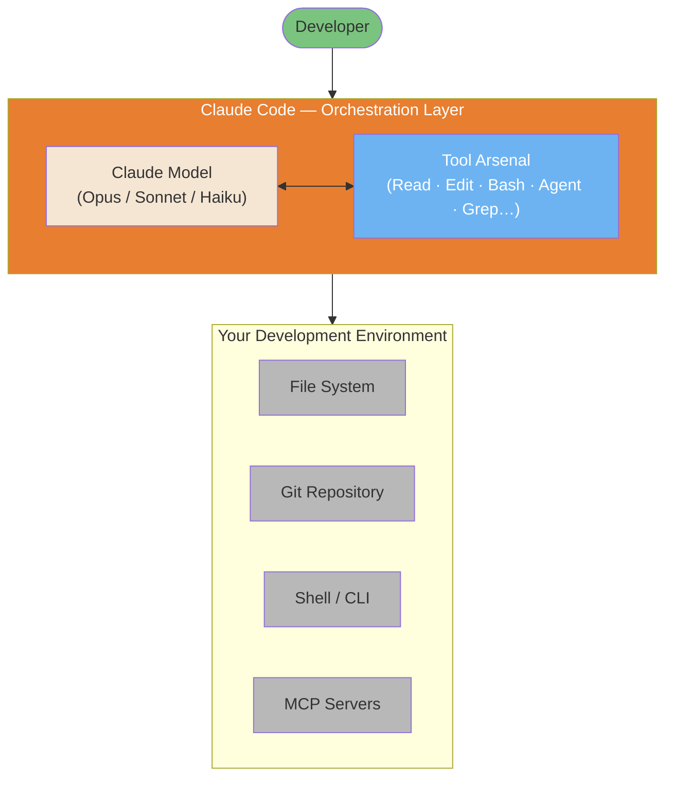

# Как работает Claude Code: архитектура и внутреннее устройство

> Техническое руководство по документированному поведению Claude Code с отдельно атрибутированными наблюдениями сообщества. Цитируемые исторические исследования не подтверждают текущее внутреннее устройство.

**Автор**: Florian BRUNIAUX | При участии Claude (Anthropic)

**Время чтения**: ~25 минут (полностью) | ~5 минут (только краткое содержание)

**Последняя проверка**: октябрь 2026 года — для перечня инструментов, а также исправленных ниже утверждений о контекстном окне и субагентах. Для остальных разделов сохраняются даты цитируемых источников.

---

## Прозрачность источников

Этот документ объединяет источники трёх уровней:

| Уровень | Описание | Ограничение доказательности | Пример |
|------|-------------|------------|---------|
| **Уровень 1** | Официальная документация Anthropic | Контракт или поведение для указанных версии, даты и области применения | документация code.claude.com |
| **Уровень 2** | Цитируемое исследование или обратная разработка | Наблюдение ограничено исследованной версией и использованным методом | анализ PromptLayer |
| **Уровень 3** | Вывод сообщества | Непроверенное объяснение, не являющееся контрактом продукта | Наблюдалось, но официально не подтверждено |

Метки источников указывают на происхождение данных, а не на измеренную степень уверенности. Отдавайте предпочтение актуальной официальной документации; исторические наблюдения ограничены датами и методами своих источников.

---

## Место Claude Code в стеке обвязки агента

Claude Code — это **рантайм-харнесс**: он управляет итеративным циклом взаимодействия модели и инструментов при выполнении задачи программирования. Модель генерирует токены; репозиторий предоставляет инструкции, настройку, состояние и средства проверки; оркестратор координирует несколько рантайм-сессий. Эти слои отвечают на разные вопросы, поэтому их не следует оценивать как взаимозаменяемые продукты.

Ознакомьтесь с [Инженерией обвязки агента](./agent-harness.md), чтобы изучить четырёхслойную модель и внутренние механизмы рантайма. Используйте [Карту обвязок агентов](../ecosystem/agent-harness-landscape.md), сравнивая продукты, управляющие циклом программирования. В разделе [Инструменты агентов: за пределами Claude Code](../ecosystem/agentic-tools.md) рассматривается более широкий набор фреймворков, плоскостей управления и смежных с рантаймом инструментов. Термины, используемые на этих страницах, определены в [глоссарии](./glossary.md).

### Claude Code и Agent SDK

Claude Code — это продукт, который запускается в терминале, IDE или настольном приложении. Claude Agent SDK — библиотека, встраивающая агента Claude Code в ваше приложение на Python или TypeScript. Согласно [официальному обзору Agent SDK](https://code.claude.com/docs/en/agent-sdk/overview), она запускает бинарный файл Claude Code и предоставляет те же инструменты, цикл агента и управление контекстом, включая права доступа, сессии, хуки, субагентов и MCP. Поэтому описанные на этой странице механизмы цикла и контекста также относятся к агентам, созданным с помощью SDK. Ограничение цикла, относящееся только к SDK, рассматривается в разделе [Управление глубиной цикла с помощью max_turns](#controlling-loop-depth-with-max_turns). Сравнение SDK с другими фреймворками агентов приведено в разделе [Инструменты агентов §3.4](../ecosystem/agentic-tools.md#34-anthropic-agent-sdk).

---

## Краткое содержание — 5 пунктов

1. **Агентный цикл**: модель предлагает инструменты или ответ; перед выполнением инструментов харнесс проверяет права доступа. В автоматическом режиме может использоваться классификатор. Этот цикл — учебная модель, а не полное описание всех компонентов рантайма. [Система прав доступа](https://code.claude.com/docs/en/permissions#permission-system).

2. **Встроенные и расширяемые инструменты**: Claude Code предоставляет редактирование файлов, доступ к оболочке, поиск, субагентов и другие встроенные возможности. Доступный набор зависит от версии, модели и конфигурации; актуальный перечень приведён в [справочнике по инструментам](https://code.claude.com/docs/en/tools-reference).

   **Эволюция стратегии поиска**: ранние версии Claude Code экспериментировали с RAG, используя эмбеддинги Voyage для семантического поиска по коду. Anthropic перешла на агентный поиск на основе grep (ripgrep), после того как внутренние тесты показали более высокую производительность при меньшей операционной сложности: не требуется синхронизация индекса и отсутствуют риски безопасности, связанные с внешними поставщиками эмбеддингов. Эта философия «Ищи, а не индексируй» обменивает задержку и токены на простоту и безопасность. Для специализированных задач доступны плагины сообщества (ast-grep для AST-шаблонов) и MCP-серверы (Serena для символов, grepai для RAG).

   *Источник*: [подкаст Latent Space](https://www.latent.space/p/claude-code) (май 2025 года), документация ast-grep

3. **Зависящий от модели бюджет контекста**: контекстное окно совместно используется инструкциями, историей, результатами инструментов и ответами. Поддерживаемые модели и конфигурации учётных записей могут предоставлять 200 тыс. или 1 млн токенов; доступность и параметры автоматического сжатия контекста описаны в разделе [конфигурации модели](https://code.claude.com/docs/en/model-config#extended-context).

4. **Контекст субагентов**: обычные субагенты начинают с чистого контекста; форки наследуют родительскую беседу на момент создания. Разделение контекста не изолирует файловую систему или внешние эффекты. Обычное делегирование имеет настраиваемое ограничение глубины — по умолчанию три уровня ниже основной беседы; форки не могут создавать дополнительные форки. [Режимы и ограничения субагентов](https://code.claude.com/docs/en/sub-agents).

5. **Философия**: «Меньше обвязки, больше модели». Доверяйте рассуждениям Claude вместо построения вокруг него сложных систем оркестрации.

---

<a id="visual-overview"></a>
## Визуальный обзор

Claude Code — не новая ИИ-модель. Это слой оркестрации, который дополняет Claude (Opus/Sonnet/Haiku) возможностью читать файлы, выполнять команды оболочки, перемещаться по репозиториям и создавать субагентов — всё это в непрерывном цикле до завершения задачи.



*Вдохновлено [схемой архитектуры Mohamed Ali Ben Salem](https://www.linkedin.com/posts/mohamed-ali-ben-salem-2b777b9a_en-ce-moment-je-vois-passer-des-posts-du-activity-7420592149110362112-eY5a). Более подробное представление см. в разделе [Схемы внутреннего устройства архитектуры](../diagrams/04-architecture-internals.md).*

---

## Оглавление

- [Визуальный обзор](#visual-overview)

1. [Главный цикл](#1-the-master-loop)
2. [Арсенал инструментов](#2-the-tool-arsenal)
3. [Внутреннее устройство управления контекстом](#3-context-management-internals)
4. [Архитектура субагентов](#4-sub-agent-architecture)
5. [Модель прав доступа и безопасности](#5-permission--security-model)
6. [Интеграция MCP](#6-mcp-integration)
7. [Расширенные схемы использования инструментов (API)](#7-advanced-tool-use-patterns-api)
8. [Инструмент Edit: как он работает на самом деле](#8-the-edit-tool-how-it-actually-works)
9. [Сохранение сессий](#9-session-persistence)
10. [Философия: меньше обвязки, больше модели](#10-philosophy-less-scaffolding-more-model)
11. [Claude Code в сравнении с альтернативами](#11-claude-code-vs-alternatives)
12. [Источники и ссылки](#12-sources--references)
13. [Приложение: чего мы не знаем](#13-appendix-what-we-dont-know)


---

<a id="1-the-master-loop"></a>
## 1. Главный цикл

**Категория источника**: уровень 1, официальный; ограничен указанными версией, датой и областью применения.
**Источник**: [блог Anthropic Engineering](https://www.anthropic.com/engineering/claude-code-best-practices)

На схеме показан центральный цикл, где оценка прав доступа сведена к этапу работы с инструментом. Жизненный цикл хуков, сжатие контекста, повторные попытки и подробности делегирования опущены.

```
┌─────────────────────────────────────────────────────────────┐
│                   ГЛАВНЫЙ ЦИКЛ CLAUDE CODE                 │
├─────────────────────────────────────────────────────────────┤
│                                                             │
│   ┌──────────────┐                                          │
│   │  Ваш промпт  │                                          │
│   └──────┬───────┘                                          │
│          │                                                  │
│          ▼                                                  │
│   ┌──────────────────────────────────────────────────────┐  │
│   │                                                      │  │
│   │                 CLAUDE РАССУЖДАЕТ                   │  │
│   │            (Выбирает следующее действие)            │  │
│   │                                                      │  │
│   └────────────────────────┬─────────────────────────────┘  │
│                            │                                │
│                            ▼                                │
│                   ┌────────────────┐                        │
│                   │Вызов инструмента?│                      │
│                   └───────┬────────┘                        │
│                           │                                 │
│              ДА           │           НЕТ                   │
│         ┌─────────────────┴─────────────────┐               │
│         │                                   │               │
│         ▼                                   ▼               │
│  ┌────────────┐                      ┌────────────┐         │
│  │  Оценить   │                      │ Текстовый  │         │
│  │   права    │                      │   ответ    │         │
│  │выполнить/  │                      │ (ГОТОВО)   │         │
│  │ отказать   │                      │            │         │
│  └─────┬──────┘                      └────────────┘         │
│        │                                                    │
│        ▼                                                    │
│  ┌─────────────┐                                            │
│  │  Передать   │                                            │
│  │результат Claude│────────────────┐                        │
│  └─────────────┘                  │                         │
│                                   │                         │
│                                   ▼                         │
│                          ┌────────────────┐                 │
│                          │ ВЕРНУТЬСЯ В ЦИКЛ│                │
│                          │(Следующая итерация)│              │
│                          └────────────────┘                 │
│                                                             │
└─────────────────────────────────────────────────────────────┘
```

### Что это означает

Упрощённый учебный псевдокод, не являющийся реализацией системы прав доступа или хуков:

```
while (claude_response.has_tool_call):
    result = evaluate_permissions_and_run_or_refuse(tool_call)
    claude_response = send_to_claude(result)
return claude_response.text
```

Модель выбирает следующее действие с учётом ограничений харнесса. [Правила доступа](https://code.claude.com/docs/en/permissions#permission-system) применяются Claude Code, а в автоматическом режиме может использоваться классификатор. Необязательные рабочие процессы и расширения добавляют другие пути управления; эта схема не доказывает их отсутствия. См. [как работает Claude Code](https://code.claude.com/docs/en/how-claude-code-works) и актуальный [перечень инструментов](https://code.claude.com/docs/en/tools-reference).

### Почему выбрана такая архитектура?

1. **Простота**: меньше компонентов — меньше вариантов отказа
2. **Управление моделью**: рассуждения Claude эффективнее эвристик, написанных вручную
3. **Гибкость**: отсутствует жёсткий конвейер, ограничивающий возможности Claude
4. **Удобство отладки**: легко понять, что произошло и почему

### Терминология API агентного цикла

Приведённая выше схема главного цикла показывает процесс концептуально, однако Messages API выражает его через конкретные значения `stop_reason`. Следующие три распространённых значения иллюстрируют цикл; полный список приведён в [официальном справочнике по причинам остановки](https://platform.claude.com/docs/en/build-with-claude/handling-stop-reasons).

| `stop_reason` | Значение | Действие цикла |
|---------------|---------|-------------|
| `tool_use` | Claude хочет вызвать один или несколько инструментов | Выполнить инструменты, передать результаты обратно и продолжить цикл |
| `end_turn` | Claude решил, что закончил работу | Выйти из цикла и вернуть текстовый ответ |
| `max_tokens` | Достигнут запрошенный лимит токенов вывода | Увеличить лимит вывода или продолжить ответ |

С этими именами псевдокод становится точным:

```python
messages = [{"role": "user", "content": user_prompt}]

while True:
    response = client.messages.create(model=model, messages=messages, tools=tools)

    if response.stop_reason == "end_turn":
        return response.content[0].text  # готово

    if response.stop_reason == "tool_use":
        # Обработать каждый блок tool_use в ответе
        tool_results = []
        for block in response.content:
            if block.type == "tool_use":
                result = execute_tool(block.name, block.input)
                tool_results.append({
                    "type": "tool_result",
                    "tool_use_id": block.id,
                    "content": result
                })
        messages.append({"role": "assistant", "content": response.content})
        messages.append({"role": "user", "content": tool_results})
        # цикл продолжается
```

Блок `tool_use` внутри `response.content` содержит три поля, с которыми нужно работать: `id` (для сопоставления с результатами), `name` (имя вызываемой функции) и `input` (словарь аргументов). Отправляемый обратно результат должен ссылаться на `tool_use_id`, чтобы модель могла сопоставить вызов и ответ.

**`fork_session`** — высокоуровневая концепция, построенная на этом цикле: она создаёт независимую ветвь текущей беседы, совместно использующую ту же историю сообщений до точки ветвления. Обе ветви могут одновременно исследовать разные подходы или конфигурации — подобно `git branch`, но для сессий агентов. Каждый форк независимо выполняет собственный агентный цикл, что удобно для сравнения ответов при разных конфигурациях инструментов или вариантах промпта без повторного выполнения всей беседы с нуля.

#### Управление глубиной цикла с помощью max_turns

`max_turns` ограничивает число итераций ассистента и инструментов до завершения работы оркестратора. Без явного ограничения вышедший из-под контроля цикл может исчерпать бюджет или контекстное окно так, что впоследствии причину будет трудно диагностировать.

Практические диапазоны по типам задач:

| Тип задачи | Рекомендуемое значение `max_turns` |
|---|---|
| Простой поиск данных (один запрос) | 5 |
| Исследование или многоэтапное программирование | 20–30 |
| Продолжительные автономные рабочие процессы | 50 |

`max_turns` — это ограничение цикла Agent SDK, а не значение `stop_reason` Messages API. При достижении этого ограничения задача может остаться незавершённой. Проверьте итоговое сообщение результата SDK на наличие `subtype == "error_max_turns"`, как описано в [справочнике по Python Agent SDK](https://code.claude.com/docs/en/agent-sdk/python):

```python
from claude_agent_sdk import ClaudeAgentOptions, ResultMessage, query

# Внутри асинхронной функции; handle_incomplete — функция обратного вызова вашего приложения.
async for message in query(prompt=task, options=ClaudeAgentOptions(max_turns=20)):
    if isinstance(message, ResultMessage) and message.subtype == "error_max_turns":
        handle_incomplete(message)
```

Настройка `max_turns` по типам задач, а не глобально, не позволяет одной медленной задаче лишить ресурсов остальные задачи в многоагентном конвейере. Ночная пакетная задача, которой обоснованно требуется 50 итераций, не должна наследовать то же ограничение, что и быстрый поиск, который должен завершаться за 5.

### Аудит встроенных возможностей

Используйте этот список, чтобы проверить своё понимание полного набора возможностей Claude Code. Каждая возможность подробно описана в других разделах этого руководства.

**11 встроенных возможностей**:

- [ ] **Хуки событий**: скрипты Bash/PowerShell, запускаемые при выполнении инструментов
  - PreToolUse, PostToolUse, UserPromptSubmit, Notification
  - См.: [раздел 5 «Хуки»](#5-permission--security-model)

- [ ] **Хуки уровня скилла**: хуки событий, относящиеся к контексту выполнения конкретного скилла
  - Управление жизненным циклом для каждого скилла
  - См.: [раздел 5.11 полного руководства](#51-understanding-skills)

- [ ] **Фоновые агенты**: асинхронное выполнение задач (наборы тестов, длительные операции)
  - Неблокирующее создание агентов
  - См.: [раздел 4.2 «Архитектура субагентов»](#4-sub-agent-architecture)

- [ ] **Субагент Explore**: `/explore` для анализа кодовой базы
  - Исследование кодовой базы только для чтения
  - См.: [раздел 4.2 «Субагенты»](#4-sub-agent-architecture)

- [ ] **Субагент Plan**: `/plan` для режима планирования только для чтения
  - Безопасное исследование архитектуры
  - См.: [раздел 2.3 полного руководства](#23-plan-mode)

- [ ] **Инструмент Agent**: иерархическое делегирование задач специализированным агентам
  - Параллельное выполнение задач; вложенность настраивается (по умолчанию три уровня)
  - См.: [раздел 4.2 «Архитектура субагентов»](#4-sub-agent-architecture)

- [ ] **Команды агентов (Agent Teams)**: параллельная координация нескольких агентов (экспериментальная возможность, v2.1.32+)
  - Координация на основе Git, автономное назначение задач
  - См.: [раздел 9.20 полного руководства](#920-agent-teams-multi-agent-coordination)

- [ ] **Выбор модели для каждой задачи**: динамическое переключение модели в ходе сессии
  - `/model opus|sonnet|haiku` на границах задач
  - См.: [раздел 10 «Оптимизация затрат»](#10-claude-code-vs-alternatives)

- [ ] **Интеграция протокола MCP**: Model Context Protocol для расширения набора инструментов
  - Context7, Sequential, Serena, Playwright и т. д.
  - См.: [раздел 6 «Интеграция MCP»](#6-mcp-integration)

- [ ] **Режимы прав доступа**: детальное управление выполнением инструментов
  - Режим по умолчанию, автоматическое подтверждение, режим планирования, пользовательские правила
  - См.: [раздел 5 «Модель прав доступа и безопасности»](#5-permission--security-model)

- [ ] **Память сессии**: сохранение контекста между сессиями
  - CLAUDE.md, файлы памяти, состояние проекта
  - См.: [раздел 8 «Сохранение сессий»](#8-session-persistence)

**Совет по началу работы**: если вы ещё не изучили все 11 возможностей, вероятно, вы упускаете способы повысить продуктивность. Сосредоточьтесь на неотмеченных пунктах выше.

**Источник**: обобщено на основе [анализа Gur Sannikov](https://www.linkedin.com/posts/gursannikov_claudecode-embeddedengineering-aiagents-activity-7423851983331328001-DrFb)

---

<a id="2-the-tool-arsenal"></a>
## 2. Арсенал инструментов

**Категория источника**: уровень 1, официальный; ограничен указанными версией, датой и областью применения.
**Источник**: [code.claude.com/docs](https://code.claude.com/docs/en/setup)

Приведённые ниже инструменты являются примерами, а не исчерпывающим перечнем. Доступность по моделям и конфигурациям указана в [актуальном справочнике по инструментам](https://code.claude.com/docs/en/tools-reference).

| Инструмент | Назначение | Ключевое поведение | Расход токенов |
|------|---------|--------------|------------|
| `Bash` | Выполнение команд оболочки | Универсальный адаптер, самый мощный инструмент | Низкий (команда) + переменный (вывод) |
| `Read` | Чтение содержимого файлов | Не более 2000 строк, поддерживает усечение | Высокий для больших файлов |
| `Edit` | Изменение существующих файлов | Основан на различиях, требует точного совпадения | Средний |
| `Write` | Создание или перезапись файлов | Если файл существует, сначала его необходимо прочитать | Средний |
| `Grep` | Поиск по содержимому файлов | Основан на ripgrep (регулярные выражения), заменил подход с RAG/эмбеддингами. Для структурного поиска по коду (на основе AST) см. плагин ast-grep. Компромисс: Grep (быстро и просто), ast-grep (точно, но требует настройки), Serena MCP (семантический поиск с учётом символов) | Низкий |
| `Glob` | Поиск файлов по шаблону | Сопоставление путей, сортировка по времени изменения | Низкий |
| `Agent` | Создание субагентов (ранее `Task`) | Чистый или ответвлённый контекст; обычная вложенность настраивается (по умолчанию три уровня); воздействия на файловую систему могут быть общими | Зависит от режима делегирования |
| `TodoWrite` / инструменты задач | Отслеживание прогресса | Доступные инструменты и значения по умолчанию зависят от модели и конфигурации; см. [актуальный справочник по инструментам](https://code.claude.com/docs/en/tools-reference) | Зависит от списка задач |

### Универсальный адаптер Bash

**Ключевая идея**: Bash — универсальный инструмент Claude. Он позволяет:

- Запускать любой CLI-инструмент (git, npm, docker, curl...)
- Выполнять скрипты
- Объединять команды конвейерами
- Получать доступ к состоянию системы

Модель обучена на огромном объёме данных об оболочках, поэтому она очень эффективно использует Bash как универсальный адаптер, когда специализированных инструментов недостаточно.

### Логика выбора инструментов

Claude решает, какой инструмент использовать, исходя из задачи. Жёстко заданной маршрутизации нет:

```
┌─────────────────────────────────────────────────────┐
│          ВЫБОР ИНСТРУМЕНТА (УПРАВЛЯЕТСЯ МОДЕЛЬЮ)   │
├─────────────────────────────────────────────────────┤
│                                                     │
│  «Прочитай auth.ts»       → инструмент Read         │
│  «Найди все файлы тестов» → инструмент Glob         │
│  «Найди TODO»             → инструмент Grep         │
│  «Запусти npm test»       → инструмент Bash         │
│  «Исследуй кодовую базу»  → Agent (субагент)        │
│  «Отслеживай мой прогресс»→ доступные инструменты   │
│                              задач                  │
│                                                     │
│  Модель усваивает эти шаблоны во время обучения,    │
│  а не получает их из явно заданных правил.          │
│                                                     │
└─────────────────────────────────────────────────────┘
```

### Расширенная экосистема инструментов

Помимо встроенных инструментов, перечисленных в [справочнике по инструментам](https://code.claude.com/docs/en/tools-reference), Claude Code может использовать:

**MCP-серверы** (Model Context Protocol):
- **Serena**: навигация по коду с учётом символов + память сессии
- **grepai**: семантический поиск + анализ графа вызовов (на основе Ollama)
- **Context7**: поиск по официальной документации библиотек
- **Sequential**: структурированные многоэтапные рассуждения
- **Playwright**: автоматизация браузера и E2E-тестирование
- **claude-code-ultimate-guide**: 12 инструментов: поиск по руководству, отслеживание выпусков, `compare_versions`, поиск угроз безопасности (`get_threat`, `list_threats` с 28 CVE и 655 вредоносными скиллами), поиск шаблонов (`search_examples`); установка с помощью `npx -y claude-code-ultimate-guide-mcp`

**Плагины сообщества**:
- **ast-grep**: структурный поиск по коду на основе AST (явный вызов)

### Матрица выбора инструмента поиска

Claude Code предлагает несколько способов поиска по коду, каждый со своими преимуществами:

| Задача поиска | Встроенный инструмент | Альтернатива MCP/плагин | Когда переходить к более мощному инструменту |
|-------------|-------------|----------------------|------------------|
| Точный текст | `Grep` (ripgrep) | — | Никогда (самый быстрый вариант) |
| Имя функции | `Grep` | Serena `find_symbol` | Рефакторинг в нескольких файлах |
| По смыслу | — | grepai `search` | Точный текст неизвестен |
| Граф вызовов | — | grepai `trace_callers` | Анализ зависимостей |
| Структурный шаблон | — | ast-grep | Крупные миграции (>50 тыс. строк) |
| Структура файла | — | Serena `get_symbols_overview` | Нужен контекст символов |

**Сравнение производительности**:

| Инструмент | Скорость | Настройка | Сценарий использования |
|------|-------|-------|----------|
| Grep (ripgrep) | ⚡ ~20 мс | ✅ Не требуется | 90% поисковых задач |
| Serena | ⚡ ~100 мс | ⚠️ MCP | Рефакторинг, символы |
| grepai | 🐢 ~500 мс | ⚠️ Ollama + MCP | Семантический поиск, граф вызовов |
| ast-grep | 🕐 ~200 мс | ⚠️ Плагин | AST-шаблоны, миграции |

**Принцип принятия решения**: начинайте с Grep (самый быстрый вариант) и переходите к специализированным инструментам только при необходимости.

> **📖 Глубокий разбор**: комплексные рабочие процессы, объединяющие все инструменты поиска, описаны в разделе [Мастерское владение инструментами поиска](../workflows/search-tools-mastery.md).

---

<a id="3-context-management-internals"></a>
## 3. Внутреннее устройство управления контекстом

**Категория источника**: уровень 2, частично официальный; ограничен указанными наблюдением и методом.
**Источники**:
- [platform.claude.com/docs](https://platform.claude.com/docs/en/build-with-claude/context-windows) (уровень 1)
- Наблюдаемое поведение (уровень 2)

Размер контекстного окна Claude Code зависит от модели, тарифного плана и поставщика. Поддерживаемые конфигурации предоставляют 200 тыс. или 1 млн токенов; см. [расширенный контекст](https://code.claude.com/docs/en/model-config#extended-context).

### Распределение бюджета контекста

```
┌─────────────────────────────────────────────────────────────┐
│          БЮДЖЕТ КОНТЕКСТА (ЗАВИСИТ ОТ МОДЕЛИ)              │
├─────────────────────────────────────────────────────────────┤
│                                                             │
│  ┌──────────────────────────────────────────────────────┐   │
│  │ Системный промпт                       (переменный)  │   │
│  │ • Определения инструментов                           │   │
│  │ • Инструкции по безопасности                         │   │
│  │ • Правила поведения                                  │   │
│  │ • Подробное описание приведено ниже ↓                │   │
│  ├──────────────────────────────────────────────────────┤   │
│  │ Файлы и правила CLAUDE.md               (переменный)  │   │
│  │ • Глобальный ~/.claude/CLAUDE.md                      │   │
│  │ • Проектный CLAUDE.md или .claude/CLAUDE.md           │   │
│  │ • Встроенные файлы .claude/rules/                     │   │
│  ├──────────────────────────────────────────────────────┤   │
│  │ История беседы                         (переменный)  │   │
│  │ • Ваши промпты                                       │   │
│  │ • Ответы Claude                                      │   │
│  │ • Записи о вызовах инструментов                      │   │
│  ├──────────────────────────────────────────────────────┤   │
│  │ Результаты инструментов                (переменный)  │   │
│  │ • Содержимое файлов из Read                          │   │
│  │ • Вывод команд из Bash                               │   │
│  │ • Результаты поиска из Grep                          │   │
│  ├──────────────────────────────────────────────────────┤   │
│  │ Резерв для ответа/сжатия контекста     (переменный)  │   │
│  │ • Рассуждения Claude                                 │   │
│  │ • Сгенерированный код/текст                          │   │
│  └──────────────────────────────────────────────────────┘   │
│                                                             │
│  Измеряйте сессию с помощью /context; фиксированного        │
│  свободного бюджета нет                                     │
│                                                             │
└─────────────────────────────────────────────────────────────┘
```

<a id="system-prompt-contents"></a>
### Содержимое системного промпта

**Категория источника**: уровень 1, официальная документация Anthropic; ограничена указанными версией, датой и областью применения.
**Источники**:
- [Настройки Claude Code: публикация системного промпта](https://code.claude.com/docs/en/settings#change-a-setting)
- [Как работает Claude Code: контекст](https://code.claude.com/docs/en/how-claude-code-works)
- [Примечания к выпускам системных промптов Anthropic](https://platform.claude.com/docs/en/release-notes/system-prompts/overview)
- [Anthropic Engineering: лучшие практики Claude Code](https://www.anthropic.com/engineering/claude-code-best-practices)

Согласно документации по настройкам, системный промпт Claude Code **не опубликован**. Опубликованные Anthropic промпты Claude.ai и мобильного приложения не подтверждают текст или размер в токенах текущего промпта CLI.

**Документированные компоненты контекста** включают инструкции, определения доступных инструментов, историю и результаты инструментов. Доступность инструментов зависит от модели и конфигурации. Пользовательские инструкции, такие как `CLAUDE.md`, формируют поведение; настройки прав доступа управляют разрешёнными действиями. Точная структура запроса, размер промпта и внутреннее распределение кеша здесь не подтверждены.

**Важные различия**:
- **Claude.ai/мобильное приложение**: опубликованные промпты доступны широкой публике
- **Anthropic API**: другие инструкции по умолчанию, настраиваемые разработчиками
- **Claude Code CLI**: агентный помощник по программированию с поведением, ориентированным на сбор контекста

**Исторические исследования промптов семейства Claude сообществом**, не являющиеся доказательством содержания текущего промпта Claude Code:
- **Анализ Claude 4 от Simon Willison** (май 2025 года): [глубокий разбор блоков рассуждений, правил поиска и защитных ограничений безопасности](https://simonwillison.net/2025/May/25/claude-4-system-prompt/)
- **Технический разбор PromptHub** (июнь 2025 года): [подробный анализ схем промпт-инжиниринга](https://www.prompthub.us/blog/an-analysis-of-the-claude-4-system-prompt)

→ **Перекрёстная ссылка**: последствия для безопасности рассматриваются в [разделе 5 «Модель прав доступа и безопасности»](#5-permission--security-model)

**Область кеша**: [контракт кеширования промптов API](https://platform.claude.com/docs/en/build-with-claude/prompt-caching#cache-storage-and-sharing) разделяет организации, а в Claude API, Claude Platform на AWS и Microsoft Foundry также изолирует рабочие пространства; Bedrock и Google Cloud используют изоляцию на уровне организации. Этот контракт не подтверждает внутреннюю структуру кеша Claude Code. Повторное использование данных форками отдельно документировано в [справочнике по субагентам](https://code.claude.com/docs/en/sub-agents#how-forks-differ-from-other-subagents).

---

<a id="auto-compaction"></a>
### Автоматическое сжатие контекста

**Категория источника**: уровень 2, проверено сообществом и подкреплено исследованиями; ограничено указанными наблюдением и методом.

Когда использование контекста превышает пороговое значение, Claude Code автоматически создаёт сводку более старых реплик беседы:

| Источник | Заявленный порог | Примечания |
|--------|-------------------|-------|
| Расширение VS Code | ~75% использования (остаётся 25%) | [GitHub #11819](https://github.com/anthropics/claude-code/issues/11819) (ноябрь 2025 года) |
| Версия CLI | остаётся 1–5% | Более консервативный подход, чем в VS Code |
| Анализ PromptLayer | 92% | Историческое наблюдение |
| Steve Kinney | 95% | [Руководство по управлению сессиями](https://stevekinney.com/courses/ai-development/claude-code-session-management) (июль 2025 года) |
| Запуск пользователем `/compact` | В любое время | Ручное управление |

**Что происходит во время сжатия контекста:**
1. Более ранние реплики диалога суммируются
2. Результаты работы инструментов сокращаются
3. Недавний контекст сохраняется полностью
4. Модель получает сигнал о том, что «контекст был сжат»

**Влияние на производительность** (подтверждено исследованиями):

Недавние исследования и наблюдения практиков подтверждают **снижение качества при автоматической компакции**:

- **Производительность LLM при выполнении сложных задач снижается на 50–70%** по мере увеличения контекста с 1K до 32K токенов ([исследование деградации контекста](https://research.trychroma.com/context-rot), июль 2025 г.)
- **11 из 12 моделей демонстрируют менее 50% своей производительности на коротком контексте** при 32K токенов (бенчмарк NoLiMa)
- **Автоматическая компакция приводит к потере нюансов и нарушению ссылок** из-за повторяющихся циклов сжатия ([Claude экономит токены, но забывает всё](https://golev.com/post/claude-saves-tokens-forgets-everything/), январь 2026 г.)
- **Механизм внимания испытывает трудности** из-за нагрузки, связанной с поиском информации в сценариях с большим контекстом

**Консенсус сообщества**: ручная команда `/compact` в логических точках завершения этапов лучше, чем ожидание автоматической компакции.

**Рекомендуемая стратегия** (Lorenz, 2026 г. (исходная публикация в LinkedIn недоступна)):

| Контекст, % | Действие | Обоснование |
|-----------|--------|-----------|
| **70%** | Предупреждение — запланировать очистку | Заблаговременное уведомление |
| **85%** | Рекомендуется ручная передача сеанса | Предотвращение деградации из-за автоматической компакции |
| **95%** | Принудительная передача сеанса | Серьёзное снижение качества |

**Управление пользователем**: используйте `/compact`, чтобы вручную запустить суммирование в логических точках завершения этапов, или применяйте **передачу сеансов** (см. [Передача сеансов](#session-handoffs)), чтобы сохранить исходный замысел вместо сжатой истории.

В карточке [Компакция контекста](./ai-design-patterns.md#context-compaction) в разделе «Паттерны проектирования ИИ» перечислено, что Claude Code повторно внедряет после компакции, а что сохраняется только в сводке.

### Стратегии сохранения контекста

| Стратегия | Когда применять | Как |
|----------|-------------|-----|
| Субагенты | Исследовательские задачи | Инструмент `Agent` для отдельного контекста; общие побочные эффекты требуют координации |
| Ручная компакция | Проактивная очистка | Команда `/compact` |
| Очистка сеанса | Требуется начать заново | Команда `/clear` |
| Точечное чтение | Известно, что именно требуется | Читайте конкретные файлы, а не каталоги |
| CLAUDE.md | Постоянный контекст | Храните соглашения в файлах памяти |

### Пределы деградации сеанса

**Категория источника**: уровень 2, исследования практиков и исследования на arXiv; применимо только к приведённым наблюдениям и методике.

Эффективность Claude Code предсказуемо снижается при определённых условиях:

| Условие | Наблюдаемый порог | Проявление |
|-----------|-------------------|---------|
| Реплики диалога | **15–25 реплик** | Теряет из виду ограничения, заданные ранее |
| Накопление токенов | **80–100K токенов** | Игнорирует требования, сформулированные в начале сеанса |
| Масштаб задачи | **>5 файлов одновременно** | Несогласованные изменения, пропущенные файлы |

**Доля успешного выполнения в зависимости от масштаба** (по исследованиям практиков):

| Масштаб | Доля успеха | Пример |
|-------|--------------|---------|
| 1–3 файла | ~85% | Исправление ошибки в одном модуле |
| 4–7 файлов | ~60% | Рефакторинг функциональности в нескольких компонентах |
| 8+ файлов | ~40% | Изменения во всей кодовой базе |

**Стратегии снижения рисков**:

1. **Контрольные промпты**: «Прежде чем продолжить, кратко повтори текущие требования и ограничения».
2. **Сбросы сеанса**: начинайте новый сеанс для новых задач (`/clear`)
3. **Жёстко ограничивайте масштаб**: разбивайте крупные задачи на узкие подзадачи
4. **Используйте субагентов**: делегируйте исследование инструменту `Agent`, чтобы сохранить основной контекст

### Дрейф контекста, вызванный сбоями

Существует отдельный режим деградации, который не зависит от размера контекста: повторяющиеся сбои инструментов. Когда вызов инструмента завершается ошибкой и Claude повторяет попытку, сообщения об ошибках накапливаются в контекстном окне. Трассировки стека, шум повторных попыток и сообщения об ошибках размывают исходный замысел. Последующие попытки начинают следовать повествованию об ошибке, а не цели задачи. Контекстное окно ещё не заполнено, но соотношение полезного сигнала и шума уже ухудшилось.

Это отличается от дрейфа при компакции. Компакция решает проблему *размера* контекста; повторное внедрение после сбоя решает проблему *качества* контекста в пределах ограниченного окна.

**Паттерн**: повторно внедряйте основную инструкцию задачи при каждом сбое команды, а не только после `/compact`. Хук `PostToolUse` может добавлять к повторным промптам краткую версию исходной задачи и ограничений:

```bash
# Хук PostToolUse: повторно внедрить исходный замысел после сбоев
if [[ "$CLAUDE_TOOL_EXIT_CODE" != "0" ]]; then
  echo "НАПОМИНАНИЕ: текущая задача: $ORIGINAL_TASK_SUMMARY. Если приведённая выше ошибка не блокирует работу, проигнорируй её и продолжай двигаться к этой цели."
fi
```

Источник: [Nick Tune, Workflow DSL: предметно-ориентированные рабочие процессы Claude Code](https://nick-tune.me/blog/2026-03-01-workflow-dsl-domain-driven-claude-code-workflows/) (01.03.2026)

---

<a id="4-sub-agent-architecture"></a>
## 4. Архитектура субагентов

**Категория источника**: уровень 1, документированное поведение; ограничено указанными версией, датой и областью применения.
**Источник**: [документация по субагентам Claude Code](https://code.claude.com/docs/en/sub-agents)

Инструмент `Agent` в Claude Code делегирует работу в отдельный контекст. Эта граница не изолирует общие файлы, сервисы или внешние действия.

### Модель изоляции

На этой схеме изображён обычный субагент, не являющийся форком. Форки наследуют родительский диалог на момент создания; `isolation: "worktree"` предоставляет отдельные файлы Git, но не отдельные внешние сервисы. [Поведение форков](https://code.claude.com/docs/en/sub-agents#how-forks-differ-from-other-subagents).

```
┌─────────────────────────────────────────────────────────────┐
│                        MAIN AGENT                           │
│                                                             │
│  ┌───────────────────────────────────────────────────────┐  │
│  │ Context: Full conversation + all file reads           │  │
│  │                                                       │  │
│  │       Agent("Explore authentication patterns")        │  │
│  │                        │                              │  │
│  │                        ▼                              │  │
│  │  ┌─────────────────────────────────────────────────┐  │  │
│  │  │             SUB-AGENT (Spawned)                 │  │  │
│  │  │                                                 │  │  │
│  │  │  • Own fresh context window                     │  │  │
│  │  │  • Task, definition and applicable context     │  │  │
│  │  │  • Tools vary by agent and permission settings  │  │  │
│  │  │  • May delegate (default depth: 3 layers)       │  │  │
│  │  │  • Returns: summary text only                   │  │  │
│  │  │                                                 │  │  │
│  │  └─────────────────────────────────────────────────┘  │  │
│  │                        │                              │  │
│  │                        ▼                              │  │
│  │         Result: "Found 3 auth patterns: JWT in..."    │  │
│  │         (Only this text enters main context)          │  │
│  │                                                       │  │
│  └───────────────────────────────────────────────────────┘  │
│                                                             │
└─────────────────────────────────────────────────────────────┘
```

### Вложенность и ограничения

По умолчанию субагенты могут делегировать задачи на глубину до трёх уровней ниже основного диалога. [Ограничение глубины](https://code.claude.com/docs/en/sub-agents#let-subagents-spawn-their-own-subagents) можно настроить; субагент без инструмента агента не может делегировать задачи. Каждый агент использует собственный контекст и учитывается в лимитах использования, поэтому вложенное делегирование требует явных границ задач.

Форки не могут создавать другие форки. Новые субагенты также могут загружать применимые инструкции и предварительно загруженные скиллы; они получают больше данных, чем одна строка задачи. [Контекст при запуске](https://code.claude.com/docs/en/sub-agents#what-loads-at-startup).

### Типы субагентов

Встроенные типы и ограничения инструментов зависят от версии и конфигурации. В [актуальной справке](https://code.claude.com/docs/en/sub-agents#built-in-subagents) перечислены:

| Тип | Назначение | Доступные инструменты |
|------|---------|-----------------|
| `Explore` | Исследование кодовой базы | Все инструменты только для чтения |
| `Plan` | Исследование в режиме планирования | Инструменты только для чтения; Write и Edit запрещены |
| `general-purpose` | Сложные многоэтапные задачи | Инструменты, доступные субагентам с учётом прав доступа |
| Другие вспомогательные агенты | Помощь в рамках конкретного сеанса | Зависит от вспомогательного агента и конфигурации |

### Когда использовать субагентов

| Сценарий | Чем помогает субагент |
|----------|---------------------|
| Поиск в крупных кодовых базах | Сохраняет основной контекст чистым |
| Параллельное исследование | Несколько одновременных поисков |
| Масштабное исследование | Промежуточные результаты остаются в отдельном контексте; общие побочные эффекты по-прежнему требуют контроля |
| Специализированный анализ | Разный «образ мышления» для разных задач |

### Оркестрация по модели «центр и лучи»

Предлагаемый паттерн **«центр и лучи»** назначает одного координатора ответственным за интеграцию. Следующая схема выражает эту политику координации, а не ограничение на обмен сообщениями между участниками или наследование контекста.

```
                    ┌─────────────────────┐
                    │    COORDINATOR      │
                    │  (Hub / Orchestrator)│
                    │                     │
                    │  • Decomposes goal  │
                    │  • Passes context   │
                    │  • Aggregates results│
                    │  • Resolves conflicts│
                    └──┬──────┬──────┬───┘
                       │      │      │
            ┌──────────┘      │      └──────────┐
            │                 │                 │
     ┌──────▼──────┐  ┌───────▼─────┐  ┌───────▼─────┐
     │  WORKER A   │  │  WORKER B   │  │  WORKER C   │
     │             │  │             │  │             │
     │  Specific   │  │  Specific   │  │  Specific   │
     │  task only  │  │  task only  │  │  task only  │
     └─────────────┘  └─────────────┘  └─────────────┘
           │                 │                 │
           └────────────────►│◄────────────────┘
                     (results flow back to coordinator only)
```

**Проверяйте режим делегирования.** Новым субагентам нужно явно передавать контекст задачи; форки наследуют снимок контекста. Ни те ни другие не получают автоматически последующие результаты соседнего агента. Передавайте им эти результаты или координируйте работу с помощью поддерживаемых сообщений и общих файлов. [Контекст при запуске и форки](https://code.claude.com/docs/en/sub-agents#what-loads-at-startup).

**Паттерн явной передачи контекста:**

```python
# Учебный псевдокод, а не API Claude Code
# Независимые новые исполнители не обмениваются результатами автоматически
task_a = delegate_fresh("Проанализируй auth.py и найди логику токена сеанса")
task_b = delegate_fresh("Найди все места вызова логики токена сеанса")

# Дождаться результата, затем передать его следующему новому исполнителю
result_a = await_result(task_a)
task_b = delegate_fresh(f"Найди во всей кодовой базе все места вызова {result_a}")
```

**Обязанности координатора:**

1. **Декомпозиция**: разбить цель на независимые подзадачи с чёткими границами
2. **Явная передача контекста**: описание задачи каждого исполнителя должно быть самодостаточным
3. **Агрегация**: собрать текстовые результаты всех исполнителей и объединить их в согласованный итог
4. **Решение сквозных вопросов**: в рамках этого паттерна назначить координатора ответственным за интеграционные решения

В этом предлагаемом паттерне направляйте зависимости через координатора. Прямое взаимодействие между участниками также поддерживается, если выбранный сеанс предоставляет инструменты обмена сообщениями; выбирайте политику координации, соответствующую задаче.

---

## 5. Модель прав доступа и безопасности

**Категория источника**: уровень 1, официальный источник; ограничено указанными версией, датой и областью применения.
**Источники**:
- [code.claude.com/docs/en/hooks](https://code.claude.com/docs/en/hooks)
- [code.claude.com/docs/en/sandboxing](https://code.claude.com/docs/en/sandboxing)

Claude Code использует многоуровневую модель безопасности:

```
┌─────────────────────────────────────────────────────────────┐
│                    PERMISSION LAYERS                        │
├─────────────────────────────────────────────────────────────┤
│                                                             │
│  Layer 1: INTERACTIVE PROMPTS                               │
│  ┌────────────────────────────────────────────────────────┐ │
│  │ Claude wants to run: rm -rf node_modules               │ │
│  │ [Allow once] [Allow always] [Deny] [Edit command]      │ │
│  └────────────────────────────────────────────────────────┘ │
│                          │                                  │
│                          ▼                                  │
│  Layer 2: ALLOW/DENY RULES (settings.json)                  │
│  ┌────────────────────────────────────────────────────────┐ │
│  │ {                                                      │ │
│  │   "permissions": {                                     │ │
│  │     "allow": ["Bash(npm *)", "Read"],              │ │
│  │     "deny": ["Bash(rm -rf *)"]                         │ │
│  │   }                                                    │ │
│  │ }                                                      │ │
│  └────────────────────────────────────────────────────────┘ │
│                          │                                  │
│                          ▼                                  │
│  Layer 3: HOOKS (Pre/Post execution)                        │
│  ┌────────────────────────────────────────────────────────┐ │
│  │ PreToolUse: Validate before execution                  │ │
│  │ PostToolUse: Audit after execution                     │ │
│  │ PermissionRequest: Override permission prompts         │ │
│  └────────────────────────────────────────────────────────┘ │
│                          │                                  │
│                          ▼                                  │
│  Layer 4: SANDBOX MODE (Optional isolation)                 │
│  ┌────────────────────────────────────────────────────────┐ │
│  │ Filesystem isolation + Network restrictions            │ │
│  └────────────────────────────────────────────────────────┘ │
│                                                             │
└─────────────────────────────────────────────────────────────┘
```

### Обнаружение опасных паттернов

**Категория источника**: уровень 2, наблюдаемое, но не исчерпывающее поведение; применимо только к приведённым наблюдениям и методике.

По всей видимости, Claude Code отмечает определённые паттерны для дополнительной проверки:

| Паттерн | Риск | Поведение |
|---------|------|----------|
| `rm -rf` | Разрушительное удаление | Всегда запрашивает подтверждение |
| `sudo` | Повышение привилегий | Всегда запрашивает подтверждение |
| `curl \| sh` | Удалённое выполнение кода | Всегда запрашивает подтверждение |
| `chmod 777` | Небезопасные права доступа | Всегда запрашивает подтверждение |
| `git push --force` | Уничтожение истории | Всегда запрашивает подтверждение |
| `DROP TABLE` | Уничтожение данных | Всегда запрашивает подтверждение |

Это не полный список блокировок. Вероятно, паттерны обнаруживаются благодаря обучению модели, а не явным правилам.

### Нативная песочница (v2.1.0+)

**Категория источника**: уровень 1, официальный источник; ограничено указанными версией, датой и областью применения.
**Источник**: [code.claude.com/docs/en/sandboxing](https://code.claude.com/docs/en/sandboxing)

Claude Code включает встроенную **нативную песочницу**, использующую примитивы уровня операционной системы для изоляции процессов:

```
┌──────────────────────────────────────────────────────┐
│               Native Sandbox Architecture            │
├──────────────────────────────────────────────────────┤
│                                                      │
│  Bash Command Request                                │
│       │                                              │
│       ▼                                              │
│  Sandbox Wrapper (Seatbelt/bubblewrap)               │
│       │                                              │
│       ├─ Filesystem: read all, write CWD only        │
│       ├─ Network: SOCKS5 proxy + domain filtering    │
│       ├─ Process: isolated environment               │
│       │                                              │
│       ▼                                              │
│  OS Kernel Enforcement                               │
│       │                                              │
│       ├─ Allowed: operations within boundaries       │
│       ├─ Blocked: violations at system call level    │
│       └─ Notify: user receives alert on violation    │
│                                                      │
└──────────────────────────────────────────────────────┘
```

**Примитивы ОС**:

| Платформа | Механизм | Примечания |
|----------|-----------|-------|
| **macOS** | Seatbelt (TrustedBSD MAC) | Встроенная фильтрация системных вызовов на уровне ядра |
| **Linux/WSL2** | bubblewrap (пространства имён + seccomp) | Требуется: `sudo apt-get install bubblewrap socat` |
| **WSL1** | ❌ Не поддерживается | bubblewrap нужны недоступные возможности ядра |
| **Windows** | ❌ Не поддерживается | Команды выполняются без песочницы; используйте WSL2 |

**Модель изоляции**:

1. **Файловая система**:
   - **Чтение**: весь компьютер (кроме запрещённых путей)
   - **Запись**: только текущий рабочий каталог (настраивается)
   - **Заблокировано**: изменения за пределами CWD, каталоги с учётными данными (`~/.ssh`, `~/.aws`)

2. **Сеть**:
   - **Прокси**: все соединения направляются через прокси SOCKS5
   - **Фильтрация доменов**: режим списка разрешённых или запрещённых доменов
   - **Заблокировано по умолчанию**: частные диапазоны CIDR, диапазоны localhost

3. **Процессы**:
   - **Общее ядро**: уязвимо для эксплойтов ядра (в отличие от microVM Docker)
   - **Дочерние процессы**: наследуют те же ограничения песочницы
   - **Аварийный обход**: параметр `dangerouslyDisableSandbox` для несовместимых инструментов

**Режимы песочницы**:

- **Режим автоматического разрешения**: команды Bash автоматически одобряются, если выполняются в песочнице (рекомендуется для повседневной разработки)
- **Обычный режим прав доступа**: все команды требуют явного подтверждения (повышенная безопасность)

**Компромиссы безопасности**:

| Аспект | Нативная песочница | Песочницы Docker (microVM) |
|--------|---------------|---------------------------|
| **Изоляция ядра** | ❌ Общее ядро | ✅ Отдельное ядро для каждой VM |
| **Настройка** | 0 зависимостей (macOS), 2 пакета (Linux) | Docker Desktop 4.58+ |
| **Накладные расходы** | Минимальные (~1–3% CPU) | Умеренные (~5–10% CPU) |
| **Сценарий использования** | Повседневная разработка, доверенный код | Недоверенный код, максимальная безопасность |

**Ограничения безопасности**:

⚠️ **Сокрытие домена (domain fronting)**: CDN (Cloudflare, Akamai) могут обходить фильтрацию доменов  
⚠️ **Unix-сокеты**: неверно настроенный параметр `allowUnixSockets` позволяет повышать привилегии  
⚠️ **Файловая система**: чрезмерно широкие права на запись позволяют атаковать каталоги из `$PATH`

**Когда использовать**:

- ✅ **Нативная песочница**: повседневная разработка, доверенная команда, простая настройка
- ✅ **Песочницы Docker**: недоверенный код, защита от эксплойтов ядра, необходимость Docker-in-Docker

**Подробное описание**: полную техническую справку, примеры конфигурации и рекомендации по устранению неполадок см. в [руководстве по нативной песочнице](../security/sandbox-native.md).

### Система хуков

Хуки позволяют программно управлять действиями Claude:

```json
{
  "hooks": {
    "PreToolUse": [
      {
        "matcher": "Bash",
        "hooks": [{
          "type": "command",
          "command": "/path/to/validate-command.sh"
        }]
      }
    ],
    "PostToolUse": [
      {
        "matcher": "*",
        "hooks": [{
          "type": "command",
          "command": "/path/to/audit-log.sh"
        }]
      }
    ]
  }
}
```

**Возможности хуков:**

| Возможность | Поддерживается | Как |
|------------|-----------|-----|
| Блокировка выполнения | Да | Код выхода 2 |
| Изменение параметров | Да | Возврат изменённого JSON |
| Журналирование действий | Да | Запись в файл из хука |
| Асинхронная обработка | Да | Задать `async: true` в конфигурации хука (v2.1.0+) |

**Полезная нагрузка JSON для хука** (передаётся через stdin):

```json
{
  "session_id": "abc123",
  "transcript_path": "/home/user/.claude/projects/.../transcript.jsonl",
  "cwd": "/path/to/project",
  "permission_mode": "default",
  "hook_event_name": "PreToolUse",
  "tool_name": "Bash",
  "tool_input": {
    "command": "npm install lodash"
  }
}
```

Общие поля, передаваемые для всех событий: `session_id`, `transcript_path`, `cwd`, `permission_mode`, `hook_event_name`. В дополнение к ним добавляются поля конкретного события (например, `tool_name`/`tool_input` для PreToolUse).

→ **Перекрёстная ссылка**: полные примеры см. в [разделе 7 — Хуки](#7-hooks) основного руководства.

---

<a id="6-mcp-integration"></a>
## 6. Интеграция MCP

**Категория источника**: уровень 1, официальный источник; ограничено указанными версией, датой и областью применения.
**Источник**: [code.claude.com/docs/en/mcp](https://code.claude.com/docs/en/mcp)

MCP-серверы (Model Context Protocol) расширяют Claude Code дополнительными инструментами.

<a id="mcp-architecture-overview"></a>
### Обзор архитектуры MCP

> **💡 Наглядное руководство**: следующая схема показывает, как MCP создаёт безопасный уровень управления между LLM и реальными системами. Уровень LLM **не имеет прямого доступа к данным** — MCP-сервер применяет политики безопасности до того, как инструменты смогут взаимодействовать с базами данных, API или файлами.


*Рисунок 1. Архитектура MCP, демонстрирующая разделение между мышлением (LLM), управлением (MCP-сервер) и выполнением (инструменты). Дизайн вдохновлён [визуализацией Dinesh Kumar в LinkedIn](https://www.linkedin.com/posts/dinesh-kumar-6b0528b4_model-context-protocol-mcp-why-it-came-activity-7419969525795782656-VoFh) и воссоздан по лицензии Apache-2.0.*

**Ключевые границы безопасности**:
- **Жёлтый уровень (LLM)**: только рассуждение — **нет доступа к данным**
- **Оранжевый уровень (MCP-сервер)**: точка управления безопасностью (политики, проверка, журналы)
- **Серый уровень (реальные системы)**: защищённые данные — **скрыты от ИИ**

### Как работает MCP (технические подробности)

```
┌─────────────────────────────────────────────────────────────┐
│                    MCP INTEGRATION                          │
├─────────────────────────────────────────────────────────────┤
│                                                             │
│  ┌─────────────────────────────────────────────────────┐    │
│  │                  CLAUDE CODE                        │    │
│  │                                                     │    │
│  │   Native Tools        MCP Tools                     │    │
│  │   ┌─────────┐        ┌─────────────────────────┐    │    │
│  │   │ Bash    │        │ mcp__serena__*          │    │    │
│  │   │ Read    │        │ mcp__context7__*        │    │    │
│  │   │ Edit    │        │ mcp__playwright__*      │    │    │
│  │   │ ...     │        │ mcp__custom__*          │    │    │
│  │   └─────────┘        └───────────┬─────────────┘    │    │
│  │                                  │                  │    │
│  └──────────────────────────────────┼──────────────────┘    │
│                                     │                       │
│                           JSON-RPC 2.0                      │
│                                     │                       │
│                                     ▼                       │
│  ┌─────────────────────────────────────────────────────┐    │
│  │                  MCP SERVER                         │    │
│  │                                                     │    │
│  │   stdio/HTTP transport                              │    │
│  │   Tool definitions (JSON Schema)                    │    │
│  │   Tool implementations                              │    │
│  │                                                     │    │
│  └─────────────────────────────────────────────────────┘    │
│                                                             │
└─────────────────────────────────────────────────────────────┘
```

### Основные сведения о MCP

| Аспект | Поведение |
|--------|----------|
| Протокол | JSON-RPC 2.0 поверх stdio или HTTP |
| Именование инструментов | Соглашение `mcp__<server>__<tool>` |
| Обмен контекстом | Только через параметры инструментов и возвращаемые значения |
| Жизненный цикл | Сервер запускается при первом использовании и продолжает работать в течение сеанса |
| Права доступа | Та же система, что и для нативных инструментов |

### Что MCP не может делать

| Ограничение | Объяснение |
|------------|-------------|
| Получать доступ к истории диалога | Видит только параметры инструмента, а не весь контекст |
| Сохранять состояние между вызовами | Каждый вызов независим, если сервер не реализует кеширование |
| Изменять системный промпт Claude | Только инструменты, без промпт-инъекций |
| Обходить права доступа | Тот же уровень безопасности, что и для нативных инструментов |

→ **Перекрёстная ссылка**: рекомендации по безопасности см. в [разделе 8.6 — Безопасность MCP](#86-mcp-security).

<a id="mcp-extensions-apps-sep-1865"></a>
### Расширения MCP: Apps (SEP-1865)

**Статус**: стабильно (26 января 2026 г.)
**Спецификация**: [SEP-1865 на GitHub](https://github.com/modelcontextprotocol/ext-apps)
**Соавторы**: OpenAI, Anthropic, создатели MCP-UI

#### Что такое MCP Apps?

MCP Apps — **первое официальное расширение** Model Context Protocol, позволяющее MCP-серверам предоставлять **интерактивные пользовательские интерфейсы** наряду с традиционными ответами инструментов.
**Решаемая проблема**: традиционные текстовые ответы создают трение в рабочих процессах, требующих исследования. Каждое взаимодействие (сортировка, фильтрация, детализация) требует нового цикла промпта. MCP Apps устраняет этот «контекстный разрыв», отображая интерактивные пользовательские интерфейсы непосредственно в диалоге.

#### Техническая архитектура

**Два основных примитива**:

1. **Инструменты с метаданными пользовательского интерфейса**:
   ```json
   {
     "name": "query_database",
     "description": "Query customer database",
     "_meta": {
       "ui": {
         "resourceUri": "ui://dashboard/customers"
       }
     }
   }
   ```

2. **Ресурсы пользовательского интерфейса** (схема `ui://`):
   - Серверные пакеты HTML/JavaScript
   - Отображаются хостом в изолированных iframe
   - Двунаправленное взаимодействие по JSON-RPC через `postMessage`

**Поток взаимодействия**:

```
┌─────────────────────────────────────────────────────────┐
│                  MCP APPS ARCHITECTURE                  │
├─────────────────────────────────────────────────────────┤
│                                                         │
│  ┌──────────────┐         ┌──────────────┐             │
│  │  MCP Client  │◄───────►│  MCP Server  │             │
│  │ (Claude/IDE) │ JSON-RPC│  (Your App)  │             │
│  └──────┬───────┘         └──────────────┘             │
│         │                                               │
│         │ Fetches ui:// resource                       │
│         ▼                                               │
│  ┌─────────────────────────────────────────┐            │
│  │     Sandboxed Iframe (UI Render)        │            │
│  │  ┌───────────────────────────────────┐  │            │
│  │  │  HTML/JS Bundle from Server       │  │            │
│  │  │  - Interactive dashboard           │  │            │
│  │  │  - Forms with validation           │  │            │
│  │  │  - Real-time data visualization    │  │            │
│  │  └───────────────────────────────────┘  │            │
│  │                                          │            │
│  │  postMessage ◄─────► JSON-RPC           │            │
│  └─────────────────────────────────────────┘            │
│                                                         │
└─────────────────────────────────────────────────────────┘
```

#### Модель безопасности

**Многоуровневая защита**:

| Уровень | Защита |
|-------|------------|
| **Песочница iframe** | Ограниченные права доступа (без прямого доступа к системе) |
| **Заранее объявленные шаблоны** | Хосты проверяют HTML/JS перед отображением |
| **Аудируемый обмен сообщениями** | Всё взаимодействие между пользовательским интерфейсом и хостом фиксируется в журналах JSON-RPC |
| **Согласие пользователя** | Необязательное требование для вызовов инструментов, инициированных пользовательским интерфейсом |
| **Блокировка содержимого** | Хосты могут отклонять подозрительные ресурсы до отображения |

→ **Перекрёстная ссылка**: более общие аспекты безопасности MCP см. в [разделе 8.6 — Безопасность MCP](#86-mcp-security).

#### SDK: @modelcontextprotocol/ext-apps

**Установка**:
```bash
npm install @modelcontextprotocol/ext-apps
```

**Основной API** (не зависит от фреймворка):

```typescript
import { App } from '@modelcontextprotocol/ext-apps';

const app = new App();

// 1. Establish communication with host
await app.connect();

// 2. Receive tool results from host
app.ontoolresult = (result) => {
  // Update UI with tool execution results
  updateDashboard(result.data);
};

// 3. Call server tools from UI
await app.callServerTool('fetch_analytics', {
  timeRange: '7d',
  metrics: ['users', 'revenue']
});

// 4. Update model context asynchronously
await app.updateModelContext({
  selectedFilters: ['region:EU', 'status:active']
});

// Additional capabilities:
app.logDebug('User action', { filter: 'applied' });
app.openBrowserLink('https://docs.example.com');
app.sendFollowUpMessage('Applied filters: EU, Active');
```

**Стандартное взаимодействие**: все возможности работают через `postMessage` (без привязки к фреймворку).

#### Поддержка платформ

| Платформа | Поддержка MCP Apps | Примечания |
|----------|------------------|-------|
| **Claude Desktop** | ✅ Уже доступно | claude.ai/directory (Pro/Max/Team/Enterprise) |
| **Claude Cowork** | 🔄 Скоро | Планируется интеграция с агентными рабочими процессами |
| **VS Code** | ✅ Сборка Insiders | [Официальная публикация в блоге](https://code.visualstudio.com/blogs/2026/01/26/mcp-apps-support) |
| **ChatGPT** | 🔄 Постепенное развёртывание | Неделя с 26 января 2026 года |
| **Goose** | ✅ Уже доступно | CLI с открытым исходным кодом и поддержкой пользовательского интерфейса |
| **Claude Code CLI** | ❌ Неприменимо | Только текстовый терминал (без отображения iframe) |

#### Значение для пользователей Claude Code

**Прямое использование**: отсутствует (CLI работает только с текстом и не может отображать iframe)

**Косвенные преимущества**:

1. **Понимание экосистемы**: MCP Apps представляет будущее агентных рабочих процессов
2. **Разработка MCP-серверов**: при создании собственных MCP-серверов Apps теперь можно рассматривать как один из вариантов проектирования
3. **Гибридные рабочие процессы**:
   - Используйте Claude Desktop для исследования данных с помощью Apps (дашборды, визуализации)
   - Переключайтесь на Claude Code CLI для реализации (написание скриптов, автоматизация)
4. **Контекст для конфигурации**: MCP-серверы могут заявлять о возможностях пользовательского интерфейса в метаданных

#### Примеры реализаций

**Официальные примеры серверов** (в [репозитории `ext-apps`](https://github.com/modelcontextprotocol/ext-apps)):

- **threejs-server**: трёхмерная визуализация и управление
- **map-server**: интерактивное исследование географических данных
- **pdf-server**: просмотр документов со встроенными выделениями
- **system-monitor-server**: дашборды с метриками в реальном времени
- **sheet-music-server**: отображение нотной записи

**Внедрение в рабочие продукты** (январь 2026 года):

| Инструмент | Поставщик | Возможности |
|------|----------|--------------|
| Asana | Asana | Временные шкалы проектов, доски задач |
| Slack | Salesforce | Подготовка сообщений с предварительным просмотром форматирования |
| Figma | Figma | Блок-схемы и диаграммы Ганта в FigJam |
| Amplitude | Amplitude | Аналитические диаграммы с интерактивной фильтрацией |
| Box | Box | Поиск файлов, предварительный просмотр документов |
| Canva | Canva | Дизайн презентаций с настройкой в реальном времени |
| Clay | Clay | Исследование компаний, поиск контактов |
| Hex | Hex | Анализ данных с интерактивными запросами |
| monday.com | monday.com | Доски управления работой |

**Скоро**: Salesforce (Agentforce 360)

#### Связь с предшествующими разработками

MCP Apps стандартизирует подходы, впервые реализованные в:
- **MCP-UI**: раннее расширение пользовательского интерфейса для MCP (проект сообщества)
- **OpenAI Apps SDK**: параллельная разработка для интерактивных инструментов

Оба фреймворка продолжают поддерживаться. MCP Apps предоставляет **унифицированную спецификацию** (SEP-1865), совместно разработанную сопровождающими обеих экосистем, а также Anthropic и OpenAI.

**Путь миграции**: несложный для существующих реализаций MCP-UI и Apps SDK.

#### Когда использовать MCP Apps

**Дерево решений для разработчиков MCP-серверов**:

```
Building a custom MCP server?
├─ Users need to SELECT from 50+ options? → MCP Apps (dropdown, multi-select UI)
├─ Users need to VISUALIZE data patterns? → MCP Apps (charts, maps, graphs)
├─ Users need MULTI-STEP workflows with conditional logic? → MCP Apps (wizard forms)
├─ Users need REAL-TIME updates? → MCP Apps (live dashboards)
└─ Simple data retrieval or actions only? → Traditional MCP tools (sufficient)
```

**Компромисс**: сложность пользовательского интерфейса и трудозатраты на реализацию в обмен на улучшение пользовательского опыта.

#### Ресурсы

- **Спецификация**: [SEP-1865 на GitHub](https://github.com/modelcontextprotocol/ext-apps)
- **SDK**: [`@modelcontextprotocol/ext-apps` (npm)](https://www.npmjs.com/package/@modelcontextprotocol/ext-apps)
- **Примеры серверов**: [репозиторий modelcontextprotocol/ext-apps](https://github.com/modelcontextprotocol/ext-apps)
- **Публикация в блоге (MCP)**: [Анонс MCP Apps](https://blog.modelcontextprotocol.io/posts/2026-01-26-mcp-apps/)
- **Публикация в блоге (Claude)**: [Интерактивные инструменты в Claude](https://claude.com/blog/interactive-tools-in-claude)
- **VS Code**: [Анонс поддержки MCP Apps](https://code.visualstudio.com/blogs/2026/01/26/mcp-apps-support)

---

<a id="mcp-tool-search-lazy-loading"></a>
### Поиск инструментов MCP (ленивая загрузка)

**Категория источника**: уровень 1, официальный; ограничен указанными версией, датой и областью применения.
**Источник**: [anthropic.com/engineering/advanced-tool-use](https://www.anthropic.com/engineering/advanced-tool-use)

Начиная с версии v2.1.7 (январь 2026 года) Claude Code использует **ленивую загрузку** определений инструментов MCP вместо предварительной загрузки всех инструментов в контекст. Это работает на основе возможности API [Advanced Tool Use](https://www.anthropic.com/engineering/advanced-tool-use) от Anthropic.

**Решаемая проблема:**
- Определения инструментов MCP занимают значительную часть контекста (например, один только GitHub MCP: около 46 тыс. токенов для 93 инструментов)
- Разработчик Scott Spence задокументировал потребление более 66 000 токенов ещё до ввода первого промпта
- Такое «загрязнение контекста» ограничивало практическое внедрение MCP

**Как работает поиск инструментов:**

```
┌─────────────────────────────────────────────────────────────┐
│                   MCP TOOL SEARCH FLOW                       │
├─────────────────────────────────────────────────────────────┤
│                                                             │
│  WITHOUT Tool Search (eager loading):                       │
│  ┌──────────────────────────────────────────────────────┐   │
│  │All 100+ tool definitions loaded upfront (~55K tokens)│   │
│  └──────────────────────────────────────────────────────┘   │
│                                                             │
│  WITH Tool Search (lazy loading):                           │
│  ┌──────────────────────────────────────────────────────┐   │
│  │ Step 1: Only search tool loaded (~500 tokens)        │   │
│  │ Step 2: Claude determines needed capability          │   │
│  │ Step 3: Tool Search finds matching tools (regex/BM25)│   │
│  │ Step 4: Only matched tools loaded (~600 tokens each) │   │
│  │ Step 5: Tool invoked normally                        │   │
│  └──────────────────────────────────────────────────────┘   │
│                                                             │
│  Result: 55K tokens → ~8.7K tokens (85% reduction)          │
│                                                             │
└─────────────────────────────────────────────────────────────┘
```

**Измеренные улучшения** (тесты Anthropic):

| Метрика | До | После | Улучшение |
|--------|--------|-------|-------------|
| Накладные расходы токенов (конфигурация с 5 серверами) | ~55 тыс. | ~8,7 тыс. | **Снижение на 85%** |
| Точность выбора инструментов Opus 4 | 49% | 74% | +25 п. п. |
| Точность выбора инструментов Opus 4.5 | 79,5% | 88,1% | +8,6 п. п. |
| Адаптивное мышление Opus 4.6 | Неприменимо | Автоматическая калибровка | Динамическая глубина |

**Конфигурация** (v2.1.9+):

```bash
# Environment variable
ENABLE_TOOL_SEARCH=auto      # Default (10% context threshold)
ENABLE_TOOL_SEARCH=auto:5    # Aggressive (5% threshold)
ENABLE_TOOL_SEARCH=auto:20   # Conservative (20% threshold)
ENABLE_TOOL_SEARCH=true      # Always enabled
ENABLE_TOOL_SEARCH=false     # Disabled (eager loading)
```

| Порог | Рекомендуется для |
|-----------|-----------------|
| `auto:20` | Лёгких конфигураций (5–10 инструментов) |
| `auto:10` | Сбалансированной конфигурации по умолчанию (20–50 инструментов) |
| `auto:5` | Опытных пользователей (более 100 инструментов) |

→ Как отметил Simon Willison: «Из-за загрязнения контекста я редко использовал MCP. Теперь, когда эта проблема решена, нет причин не подключить к Claude Code десятки или даже сотни MCP». (через [X/Twitter, 14 января 2026 года](https://twitter.com/simonw))

---

<a id="7-advanced-tool-use-patterns-api"></a>
## 7. Продвинутые паттерны использования инструментов (API)

**Категория источника**: уровень 1, официальный материал Anthropic Engineering; ограничен указанными версией, датой и областью применения.
**Источник**: [Anthropic Engineering: Advanced Tool Use](https://www.anthropic.com/engineering/advanced-tool-use) | [Документация по программному вызову инструментов](https://platform.claude.com/docs/en/agents-and-tools/tool-use/programmatic-tool-calling)

Четыре возможности уровня API, ставшие общедоступными 18 февраля 2026 года (вместе с Opus/Sonnet 4.6). Они актуальны для разработчиков, создающих агентов на базе Anthropic API или Agent SDK. Непосредственно в Claude Code CLI они недоступны.

| Возможность | Решаемая проблема | Доступность |
|---------|---------------|--------------|
| Программный вызов инструментов (PTC) | Циклы агентов расходуют токены на обмен запросами и ответами | API + Foundry |
| Динамическая фильтрация | Веб-поиск раздувает контекст информационным шумом | API + Foundry |
| Инструмент поиска инструментов | Слишком большое количество определений инструментов раздувает контекст | API + Foundry |
| Примеры использования инструментов | Одной схемы недостаточно для выражения паттернов использования | API + Foundry |

**Стратегия по уровням**: сначала устраните самое серьёзное узкое место:
- Контекст раздут определениями инструментов → инструмент поиска инструментов
- Большие промежуточные результаты → программный вызов инструментов
- Веб-исследования возвращают информационный шум → динамическая фильтрация
- Ошибки параметров при корректной схеме → примеры использования инструментов

### Программный вызов инструментов (PTC)

**Смена парадигмы**: вместо последовательного вызова инструментов с полным циклом обращения к модели для каждого из них Claude пишет код на Python, который управляет всеми вызовами инструментов внутри. В контекстное окно попадает только итоговый `stdout`.

```
Traditional: prompt → Claude → tool 1 → response 1 → Claude → tool 2 → response 2 → Claude → answer
             (3 tools = 3 inference passes, 3× intermediate results in context)

PTC:         prompt → Claude → writes Python → code calls tool 1, 2, 3 → stdout → Claude → answer
             (3 tools = 1 inference pass, only final output in context)
```

**Конфигурация**: пометьте инструменты, которые можно вызывать из песочницы выполнения кода, с помощью `allowed_callers`:

```json
{
  "tools": [
    { "type": "code_execution_20250825", "name": "code_execution" },
    {
      "name": "query_database",
      "description": "Execute SQL. Returns rows as JSON: id (str), name (str), revenue (float).",
      "input_schema": {
        "type": "object",
        "properties": { "sql": { "type": "string" } },
        "required": ["sql"]
      },
      "allowed_callers": ["code_execution_20250825"]
    }
  ]
}
```

| Значение `allowed_callers` | Поведение |
|-------------------------|----------|
| отсутствует / `["direct"]` | Только традиционный вызов |
| `["code_execution_20250825"]` | Вызов только из песочницы Python |
| `["direct", "code_execution_20250825"]` | Оба режима, не рекомендуется (сбивает Claude с толку) |

**Паттерны** (все выполняются за один проход вывода):
- Пакетная обработка: перебрать N элементов в цикле, агрегировать результаты, вывести сводку
- Досрочное завершение: прервать выполнение сразу после достижения критериев успеха
- Условный выбор инструмента: выбрать лёгкий или ресурсоёмкий инструмент в зависимости от промежуточного результата
- Фильтрация данных: сократить объём данных, которые видит Claude (`errors = [l for l in logs if "ERROR" in l]`)

**Эффективность использования токенов**: результаты программных вызовов инструментов никогда не попадают в контекст Claude; туда входит только итоговый `stdout`. 10 программных вызовов инструментов расходуют примерно в 10 раз меньше токенов контекста, чем 10 прямых вызовов. Утверждение об общем сокращении расхода токенов примерно на 37% основано на анализе участника сообщества Shayan Tabe и официально не подтверждено Anthropic.

**Ограничения**: только API и Foundry (не Bedrock/Vertex). MCP-инструменты, веб-поиск и получение веб-страниц, а также инструменты с `strict: true` не поддерживаются. Время жизни контейнера — около 4,5 минуты. Не подпадает под действие Zero Data Retention.

### Динамическая фильтрация для веб-поиска и получения веб-страниц

Инструменты веб-поиска и получения веб-страниц помещают в контекст полный HTML: включая навигацию, рекламу и шаблонный текст. Динамическая фильтрация позволяет Claude писать код на Python для предварительной обработки и фильтрации результатов до их попадания в контекстное окно.

**Конфигурация**: используйте обновлённые версии типов инструментов с бета-заголовком:

```json
{
  "tools": [
    { "type": "web_search_20260209", "name": "web_search" },
    { "type": "web_fetch_20260209", "name": "web_fetch" }
  ]
}
```

Обязательный заголовок: `anthropic-beta: code-execution-web-tools-2026-02-09`. При использовании этих версий типов инструментов с Sonnet 4.6 или Opus 4.6 фильтрация включена по умолчанию.

**Результаты официальных тестов** (Anthropic, набор данных BrowseComp):

| Модель | Без фильтрации | С фильтрацией | Улучшение |
|-------|-------------------|----------------|-------------|
| Sonnet 4.6 | 33,3% | 46,6% | +13,3 п. п. |
| Opus 4.6 | 45,3% | 61,6% | +16,3 п. п. |

Среднее сокращение входных токенов: около 24%. Лучше всего подходит для многоэтапных исследований, проверки цитат и извлечения конкретных данных с больших страниц.

### Примеры использования инструментов

Схемы JSON определяют структуру, но не могут выразить, когда следует включать необязательные параметры, какие их сочетания имеют смысл или какие соглашения по форматированию нужно соблюдать. Добавьте `input_examples` в определения инструментов, чтобы продемонстрировать конкретные паттерны использования:

```json
{
  "name": "create_ticket",
  "input_schema": { ... },
  "input_examples": [
    { "title": "Login page 500 error", "priority": "critical", "assignee": "oncall-team", "labels": ["bug", "auth"] },
    { "title": "Add dark mode", "priority": "low", "labels": ["feature-request"] },
    { "title": "Update API docs for v2" }
  ]
}
```

Точность при обработке сложных параметров в тестах Anthropic выросла с 72% до 90%. Используйте от 1 до 5 реалистичных примеров для каждого инструмента, охватывая минимальную, частичную и полную спецификации.

### Значение для Claude Code

| Возможность | Claude Code CLI | Действие для пользователей CLI |
|---------|----------------|---------------------|
| Поиск инструментов (ленивая загрузка MCP) | Встроен начиная с v2.1.7 в виде автоматического режима MCPSearch | Настройте `ENABLE_TOOL_SEARCH=auto:N` (описано выше в §6) |
| Примеры использования инструментов | Не настраиваются из CLI | Актуально для авторов собственных MCP-серверов; добавьте `input_examples` в схемы инструментов |
| Программный вызов инструментов | Недоступен в CLI | Актуально для разработчиков Agent SDK, создающих собственных агентов |
| Динамическая фильтрация | Недоступна в CLI | Актуально для пользователей Agent SDK, создающих конвейеры веб-исследований |

---

<a id="8-the-edit-tool-how-it-actually-works"></a>
## 8. Инструмент редактирования: как он работает на самом деле

**Категория источника**: уровень 2, проверено по поведению; ограничено указанными наблюдениями и методом.
**Источники**:
- Наблюдаемое поведение
- [github.com/cline/cline/issues/2909](https://github.com/cline/cline/issues/2909) (аналогичная реализация)

Инструмент Edit устроен сложнее, чем кажется.

### Алгоритм Edit

```
┌─────────────────────────────────────────────────────────────┐
│                     EDIT TOOL FLOW                          │
├─────────────────────────────────────────────────────────────┤
│                                                             │
│  Input: old_string, new_string, file_path                   │
│                                                             │
│         ┌──────────────────────────────────────┐            │
│         │ Step 1: EXACT MATCH                  │            │
│         │ Search for literal old_string        │            │
│         └────────────────┬─────────────────────┘            │
│                          │                                  │
│              Found?  ────┴────  Not found?                  │
│                │                     │                      │
│                ▼                     ▼                      │
│         ┌──────────┐         ┌──────────────────┐           │
│         │ REPLACE  │         │ Step 2: FUZZY    │           │
│         │  (done)  │         │ MATCH            │           │
│         └──────────┘         └────────┬─────────┘           │
│                                       │                     │
│                           Found?  ────┴────  Not found?     │
│                             │                     │         │
│                             ▼                     ▼         │
│                      ┌──────────┐         ┌──────────────┐  │
│                      │ REPLACE  │         │    ERROR     │  │
│                      │ + WARN   │         │  (mismatch)  │  │
│                      └──────────┘         └──────────────┘  │
│                                                             │
└─────────────────────────────────────────────────────────────┘
```

### Подробности нечёткого сопоставления

Если точное совпадение не найдено, инструмент Edit предпринимает следующие действия:

1. **Нормализация пробельных символов**: игнорирует пробелы в конце строк, нормализует отступы
2. **Нормализация окончаний строк**: учитывает различия между CRLF и LF
3. **Расширение контекста**: использует окружающие строки для поиска нужного места

Если нечёткое сопоставление также не удаётся, инструмент возвращает ошибку с просьбой к Claude проверить old_string.

### Проверки Edit

Перед применением изменений инструмент Edit выполняет следующие проверки:

| Проверка | Назначение |
|-------|---------|
| Файл существует | Не допустить создание файлов через Edit |
| old_string найдена | Убедиться, что редактируется нужное место |
| Единственное совпадение | old_string должна быть уникальной (иначе следует использовать `replace_all`) |
| Новое содержимое отличается | Не допустить редактирование без фактических изменений |

### Когда Edit завершается с ошибкой

| Ошибка | Причина | Реакция Claude |
|-------|-------|-------------------|
| "old_string not found" | Содержимое изменилось с момента последнего чтения | Повторно читает файл и пробует ещё раз |
| "Multiple matches" | old_string не уникальна | Использует больше строк контекста |
| "File not found" | Неверный путь | Ищет правильный путь |
<a id="9-session-persistence"></a>
## 9. Сохранение сессий

**Категория источника**: уровень 1, официальный; ограничено указанной версией/датой и областью применения.
**Источник**: [code.claude.com/docs](https://code.claude.com/docs/en/setup)

Сессии можно возобновлять между сеансами работы в терминале.

### Механизмы возобновления

| Команда | Поведение |
|---------|----------|
| `claude --continue` / `claude -c` | Возобновить последнюю сессию |
| `claude --resume <id>` / `claude -r <id>` | Возобновить конкретную сессию по ID |

### Что сохраняется

| Сохраняется | Не сохраняется |
|-----------|---------------|
| История диалога | Текущее состояние инструментов |
| Результаты вызовов инструментов | Ожидающие выполнения операции |
| ID сессии | Блокировки файлов |
| Контекст рабочего каталога | Переменные окружения |

### Формат хранения

**Категория источника**: уровень 3, вывод; объяснение не проверено.

По всей видимости, сессии хранятся в виде файлов JSON/JSONL в `~/.claude/`, однако:

- Формат не задокументирован публично
- Он не предназначен для использования в качестве стабильного API
- Он может меняться между версиями

**Не полагайтесь на формат файлов сессий** во внешних инструментах.

---

<a id="10-philosophy-less-scaffolding-more-model"></a>
## 10. Философия: меньше обвязки, больше возможностей модели

**Категория источника**: уровень 1, официальный; ограничено указанной версией/датой и областью применения.
**Источник**: Daniela Amodei (сооснователь и президент Anthropic) — публичные заявления

Основная философия Claude Code:

> «Делайте больше с меньшими затратами. Продуманные архитектурные решения, более эффективное обучение и сосредоточенность на решении задач позволяют конкурировать с грубым масштабированием».

### Что это означает на практике

| Традиционный подход | Подход Claude Code |
|---------------------|---------------------|
| Классификатор намерений → маршрутизатор → специалист | Действия под управлением модели с учётом средств контроля прав доступа |
| RAG с эмбеддингами | Grep + Glob (поиск по регулярным выражениям) |
| Оркестрация задач с помощью DAG | Центральный агентный цикл; необязательные рабочие процессы и делегирование |
| Планировщики для отдельных инструментов | Выбор инструментов моделью |
| Сложные конечные автоматы | Диалог как состояние |
| Фреймворки для промпт-инжиниринга | Доверие модели |

### Почему это работает

1. **Возможности модели**: Claude 4+ достаточно функционален, чтобы самостоятельно принимать решения о маршрутизации
2. **Сниженная задержка**: меньше компонентов — быстрее ответ
3. **Более простая отладка**: когда что-то выходит из строя, искать причину нужно только в одном месте
4. **Более качественное обобщение**: нет написанных вручную правил, которые ломаются в пограничных случаях

### Компромиссы

| Преимущество | Недостаток |
|-----------|--------------|
| Простота | Менее детальный контроль |
| Гибкость | Сложнее обеспечить строгое соблюдение заданного поведения |
| Меньше ошибок | Ошибки модели влияют на всё |
| Быстрые итерации | Требуется высокое качество модели |

### Подтверждение сообществом

Подход «сначала нативные возможности» получает всё больше подтверждений от сторонних практиков. Команды инженеров встраиваемых систем (в том числе бывшие опытные пользователи Cursor) сходятся на использовании стандарта Agent Skills вместо внешних фреймворков оркестрации, демонстрируя жизнеспособность подхода, при котором нативным рассуждениям Claude доверяют больше, чем дополнительным слоям обвязки.

**Пример**: [Gur Sannikov](https://www.linkedin.com/posts/gursannikov_claudecode-embeddedengineering-aiagents-activity-7423851983331328001-DrFb) (разработка встраиваемых систем) внедрил рабочие процессы на основе ADR, используя только нативные возможности Claude Code (хуки, скиллы, Task Tool), без внешних фреймворков, тем самым подтвердив архитектурную философию, описанную в этом руководстве.

Такое сближение подходов указывает на то, что принцип «меньше обвязки, больше возможностей модели» масштабируется лучше первоначальных ожиданий даже в сложных инженерных областях, таких как разработка встраиваемых систем.

---

<a id="11-claude-code-vs-alternatives"></a>
## 11. Claude Code в сравнении с альтернативами

**Категория источника**: уровень 2, основано на данных за март 2026 года, прошедших проверку фактов; ограничено указанными наблюдениями и методом.
**Источники**: официальная документация, исследование Perplexity за март 2026 года, журналы изменений поставщиков

| Характеристика | Claude Code | GitHub Copilot | Cursor | Amazon Q Developer |
|-----------|-------------|----------------|--------|-------------------|
| **Архитектура** | цикл while(tool) | Агент IDE + облачный агент разработки | Событийная + облачная | Агенты с интеграцией AWS |
| **Выполнение** | Локальный терминал | Локально (режим агента) + облачные ВМ | Локально + облако | Гибрид облака и локальной среды |
| **Модель** | Claude (один поставщик) | GPT, Claude, Codex (на выбор) | Несколько моделей (адаптивный выбор) | Amazon Titan + другие |
| **Контекст** | Зависит от модели и конфигурации (200 тыс. или 1 млн токенов) | Вся кодовая база (режим агента) | С учётом кодовой базы (Composer) | Варьируется (ограничено AWS) |
| **Прозрачность** | Высокая (видимые рассуждения) | Средняя | Средняя | Низкая |
| **Настройка** | CLAUDE.md + хуки + MCP | AGENTS.md, MCP (GA), пользовательские агенты | MCP Apps, .cursorrules | MCP (нативно), интеграция с AWS |
| **Поддержка MCP** | Нативная | Да (GA, автоматическое одобрение) | Да (MCP Apps v2.6) | Да (нативная) |
| **Цена** | Pro $20 / Max $100–200 | Free / Pro $10 / Pro+ $39 / Biz $19 за место | Free / Pro $20 / Biz $40 за место | Free / Pro $19 за место / Enterprise |

### Когда стоит выбрать Claude Code

| Сценарий | Claude Code | Альтернатива |
|----------|-------------|-------------|
| Глубокое исследование кодовой базы | Отлично | Хорошо |
| Рабочий процесс, ориентированный на терминал | Отлично | Ограниченно |
| Пользовательская автоматизация (хуки) | Отлично | Ограниченно |
| Стандартизация в команде | Хорошо (CLAUDE.md) | Варьируется |
| Интеграция с IDE | Ограниченно (расширение VS Code) | Cursor/Copilot лучше |
| Соответствие корпоративным требованиям | Через корпоративные решения Anthropic | Варьируется |

---

## 12. Источники и ссылки

### Уровень 1 — официальные материалы Anthropic

| Источник | URL | Темы |
|--------|-----|--------|
| Инженерный блог | anthropic.com/engineering/claude-code-best-practices | Основной цикл, философия |
| Документация по настройке | code.claude.com/docs/en/setup | Установка, аутентификация, каналы выпуска |
| Справочник команд | code.claude.com/docs/en/commands | **Первоисточник сведений о каждой встроенной слэш-команде**, псевдонимах, встроенных скиллах и рабочих процессах |
| Справочник CLI | code.claude.com/docs/en/cli-reference | Флаги и подкоманды, задаваемые при запуске |
| Контекстные окна | platform.claude.com/docs/en/build-with-claude/context-windows | Ограничения по токенам |
| Справочник хуков | code.claude.com/docs/en/hooks | Система хуков |
| Руководство по хукам | code.claude.com/docs/en/hooks-guide | Примеры хуков |
| Документация MCP | code.claude.com/docs/en/mcp | Интеграция MCP |
| Песочница | code.claude.com/docs/en/sandboxing | Модель безопасности |
| llms.txt (индекс) | code.claude.com/docs/llms.txt | Оптимизированный для LLM индекс документации, около 65 страниц |
| llms-full.txt | code.claude.com/docs/llms-full.txt | Полная документация (около 98 КБ текста) |

### Уровень 2 — проверенный анализ

| Источник | URL | Темы |
|--------|-----|--------|
| Анализ PromptLayer | blog.promptlayer.com/claude-code-behind-the-scenes-of-the-master-agent-loop/ | Внутренняя архитектура |
| Курс Steve Kinney | stevekinney.com/courses/ai-development/claude-code-* | Права доступа, сессии |

### Уровень 3 — ресурсы сообщества

| Источник | Темы |
|--------|--------|
| Обсуждения GitHub (anthropics/claude-code) | Пограничные случаи, ошибки, обсуждение функций |
| Reddit r/ClaudeAI | Опыт пользователей, обходные решения |
| Руководства на YouTube | Наглядные пошаговые разборы |

---

<a id="13-appendix-what-we-dont-know"></a>
## 13. Приложение: чего мы не знаем

Открыто перечислим пробелы в нашем понимании:

### Неизвестно или не подтверждено

| Тема | Чего мы не знаем | Уверенность в текущем понимании |
|-------|-------------------|-------------------------------------|
| **Точный порог компакции** | 75%? 85%? 92%? Зависит от модели? | 40% |
| **Содержимое системного промпта** | Полный текст не опубликован, зависит от версии модели | 30% |
| **Метод подсчёта токенов** | Точный токенизатор, накладные расходы на схемы инструментов | 50% |
| **Резервная модель** | Переключается ли Claude Code на резервную модель при сбое основной? | 20% |
| **Внутреннее кэширование** | Кэшируются ли результаты между сессиями? | 20% |
| **Логика ограничения частоты запросов** | Как лимиты запросов применяются к каждому инструменту | 40% |

### Намеренно не задокументировано

Anthropic намеренно не документирует следующее:

- Формат файлов сессий (внутренняя деталь реализации)
- Различия системного промпта между моделями
- Названия и архитектуру внутренних компонентов
- Распределение расхода токенов по компонентам
- Точный порядок проверки прав доступа

### Как оставаться в курсе

1. **Официальный журнал изменений**: следите за anthropic.com/changelog
2. **Релизы GitHub**: github.com/anthropics/claude-code/releases
3. **Discord-сообщества**: различные серверы, посвящённые Claude
4. **Это руководство**: периодически обновляется на основе проверенной информации

---

## Участие в проекте

Нашли ошибку? У вас есть новая проверенная информация? Будем рады вашему вкладу:

1. **Для официальных фактов**: укажите источник Anthropic
2. **Для наблюдений**: опишите, как вы проверили поведение
3. **Для исправлений**: объясните, что неверно и почему

---

**Последнее обновление**: февраль 2026 года
**Версия Claude Code**: v2.1.34
**Версия документа**: 1.1.0

---

## Паттерны Anthropic API для архитекторов

Три функции уровня API, которые архитекторы должны понимать при проектировании промышленных систем: Message Batches API для экономичной массовой обработки, `tool_choice` для гарантированного структурированного вывода и принудительное соблюдение JSON-схемы в строгом режиме.

---

### Message Batches API

Batches API позволяет отправить до 100 сообщений в одном HTTP-запросе и обрабатывает их асинхронно в течение 24 часов. Стоимость составляет 50% от тарифа синхронных запросов: то же качество за половину цены, но с дополнительной задержкой.

**Когда его использовать:**

| Сценарий использования | Синхронный API | Потоковая передача | Batch API |
|---|---|---|---|
| Интерактивный чат | да | да | нет |
| Анализ в реальном времени | да | да | нет |
| Массовая обработка документов | нет | нет | да (на 50% дешевле) |
| Многоходовые циклы с инструментами | да | да | нет (не поддерживается) |
| Ночной конвейер классификации | нет | нет | да |
| Крупномасштабное извлечение данных | нет | нет | да |

Batches API не поддерживает многоходовые диалоги или продолжение `tool_use` между ходами. Каждый запрос в пакете представляет собой одиночный вызов без сохранения состояния.

**Отправка, опрос состояния, получение результатов:**

```python
import anthropic
import time

client = anthropic.Anthropic()

batch = client.messages.batches.create(
    requests=[
        {
            "custom_id": f"doc-{i}",
            "params": {
                "model": "claude-opus-5-5",
                "max_tokens": 1024,
                "messages": [
                    {"role": "user", "content": f"Classify this document: {doc}"}
                ]
            }
        }
        for i, doc in enumerate(documents)
    ]
)

# Опрос до завершения (processing_status: "in_progress" | "ended")
while batch.processing_status == "in_progress":
    time.sleep(60)
    batch = client.messages.batches.retrieve(batch.id)

# Потоковая обработка результатов — у каждой записи есть custom_id и result
for result in client.messages.batches.results(batch.id):
    match result.type:
        case "succeeded":
            output = result.message.content[0].text
            process(result.custom_id, output)
        case "errored":
            log_error(result.custom_id, result.error.error.message)
        case "expired":
            requeue(result.custom_id)
```

Результаты остаются доступными в течение 29 дней после завершения пакета, а затем автоматически удаляются.

**Обработка ошибок в больших масштабах:**

Ошибки отдельных запросов не приводят к сбою всего пакета. Если из 100 запросов в пакете 3 завершатся ошибкой, он всё равно вернёт 97 успешных результатов. Паттерн для отказоустойчивых конвейеров:

1. Немедленно обработайте все результаты со статусом `succeeded`.
2. Соберите custom_id со статусом `errored` для повторной попытки с экспоненциальной задержкой.
3. Рассматривайте `expired` как некритический сбой: запрос не выполнялся, поэтому поставьте его в очередь заново.

**Экономика повторных попыток:**

Повторное синхронное выполнение отдельных неудачных элементов стоит вдвое дороже пакетного тарифа. Если доля ошибок ниже 5%, синхронные повторные попытки всё равно обходятся дешевле, чем дополнительное дробление пакетов. Если доля ошибок превышает 10%, прежде чем что-либо повторять, исследуйте промпт.

---

### tool_choice: управление вызовом инструментов

`tool_choice` определяет, может ли модель вызывать инструменты и какие именно. Доступны четыре режима:

| Значение | Поведение |
|---|---|
| `{"type": "auto"}` | Модель решает сама; она может вызвать инструменты, а может и не вызывать их (по умолчанию) |
| `{"type": "any"}` | Модель должна вызвать хотя бы один инструмент из предоставленного списка |
| `{"type": "tool", "name": "X"}` | Модель должна вызвать именно инструмент `X` |
| `{"type": "none"}` | Вызовы инструментов запрещены; модель отвечает обычным текстом |

Режимы `any` и конкретного инструмента запрашивают вызов инструмента там, где это поддерживается. Проверяйте `stop_reason` и возвращённые блоки; отказ или достижение ограничения на объём вывода не доказывают, что модель проигнорировала инструкцию.

**Принудительный вызов инструмента зависит от модели.** Перед использованием `any` или именованного инструмента проверьте совместимость с режимом рассуждений. Не делайте вывод об успехе исключительно на основании запрошенного выбора: обрабатывайте отказы, ограничения на объём вывода и фактические блоки ответа. Для JSON с ограничениями схемы используйте специальный формат ниже.

### Структурированный вывод: строгий режим

Структурированный вывод общедоступен. Используйте `output_config.format` для ответов в формате JSON или `strict: true` на уровне определения инструмента для проверки аргументов инструмента. Старый бета-заголовок и примеры с `output_format` устарели. [Официальная документация по структурированному выводу](https://platform.claude.com/docs/en/build-with-claude/structured-outputs).

```python
import json

response = client.messages.create(
    model="claude-opus-5-5",
    max_tokens=4096,
    output_config={"format": {
        "type": "json_schema",
        "schema": {
            "type": "object",
            "properties": {
                "vendor_name": {"type": ["string", "null"]},
                "total_amount": {"type": ["number", "null"]},
            },
            "required": ["vendor_name", "total_amount"],
            "additionalProperties": False,
        },
    }},
    messages=[{"role": "user", "content": invoice_text}],
)
if response.stop_reason != "end_turn":
    raise RuntimeError(f"Incomplete or refused extraction: {response.stop_reason}")
text = next(block.text for block in response.content if block.type == "text")
fields = json.loads(text)
```

Для инструментов `strict` располагается рядом с `name`, `description` и `input_schema`, а не внутри схемы. Соответствие схеме не гарантирует семантическую точность. Проверяйте извлечённые значения по документу и обрабатывайте отказы или усечённый вывод до использования результата.

**Допускающие null поля предотвращают галлюцинацию значений по умолчанию:**

Если null не разрешён, модель обязана заполнить каждое обязательное поле и скорее придумает значение, чем оставит его пустым. Допускающие null поля предоставляют модели явную возможность не указывать значение:

```json
"vendor_name": {"type": ["string", "null"]}
```

Если поле найти не удаётся, модель возвращает `null`, а не пытается угадать значение.

**Расширяемые перечисления с сопутствующими полями:**

Закрытые перечисления перестают работать, когда входные данные не соответствуют ни одной категории. Решение: добавить `"other"` последним значением перечисления и сопутствующее поле с подробностями:

```json
{
    "document_type": {
        "type": "string",
        "enum": ["invoice", "purchase_order", "receipt", "credit_note", "other"]
    },
    "document_type_detail": {
        "type": ["string", "null"],
        "description": "Заполняйте, когда document_type имеет значение 'other'; опишите фактический тип документа"
    }
}
```

Так сохраняется типобезопасность перечисления для 95% случаев, а остальные 5% корректно учитываются.

**`detected_pattern` для анализа ложных срабатываний:**

В конвейерах классификации поле `detected_pattern` показывает доказательство, на которое опиралась модель. Это превращает непрозрачную классификацию в решение, которое можно отлаживать:

```json
{
    "is_complaint": {"type": "boolean"},
    "detected_pattern": {
        "type": ["string", "null"],
        "description": "Процитируйте конкретную фразу или паттерн, послужившие основанием для классификации"
    },
    "confidence": {"type": "number"}
}
```

При `is_complaint: true` и `detected_pattern: "your service is terrible"` проверяющий человек сможет подтвердить классификацию за несколько секунд. Если же `detected_pattern: null` и `confidence: 0.6`, это сигнал передать результат на ручную проверку, а не обрабатывать его автоматически.

## Дополнительные материалы

- [Примеры](../../examples/README.md) — готовые к использованию шаблоны Claude Code
- [Рабочие процессы](../workflows/README.md) — комплексные руководства по рабочим процессам
